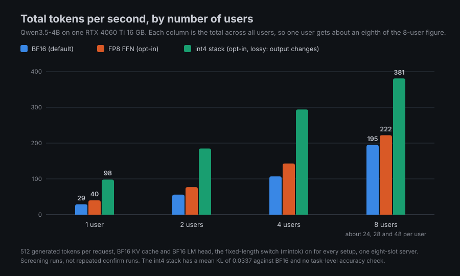
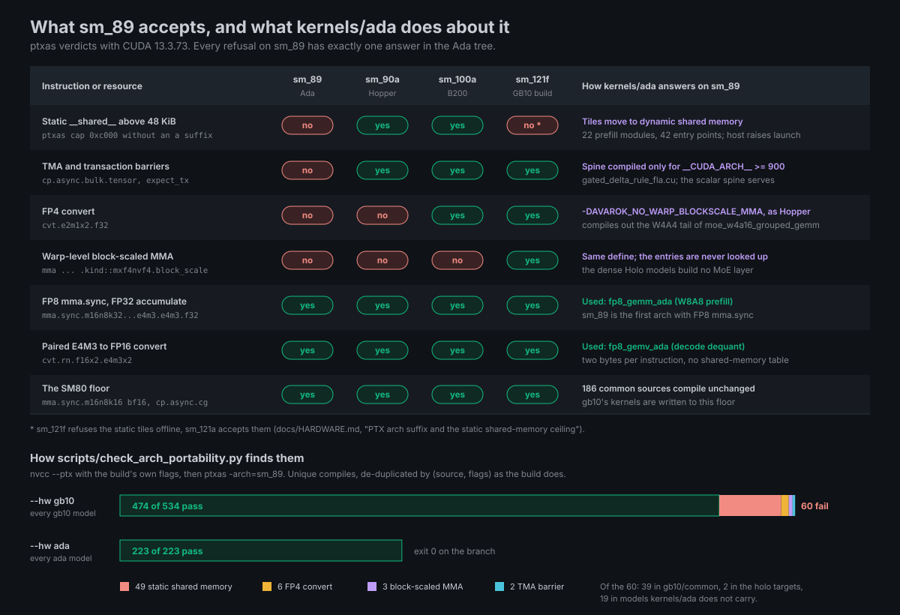
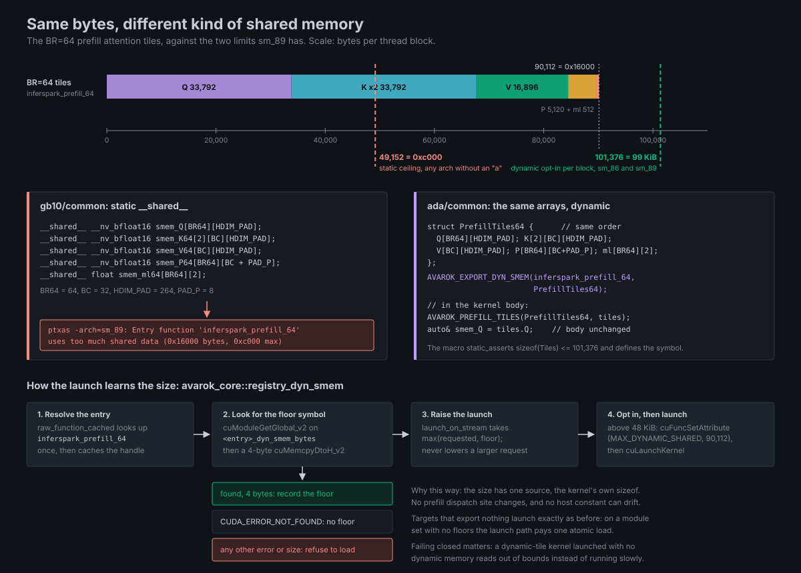
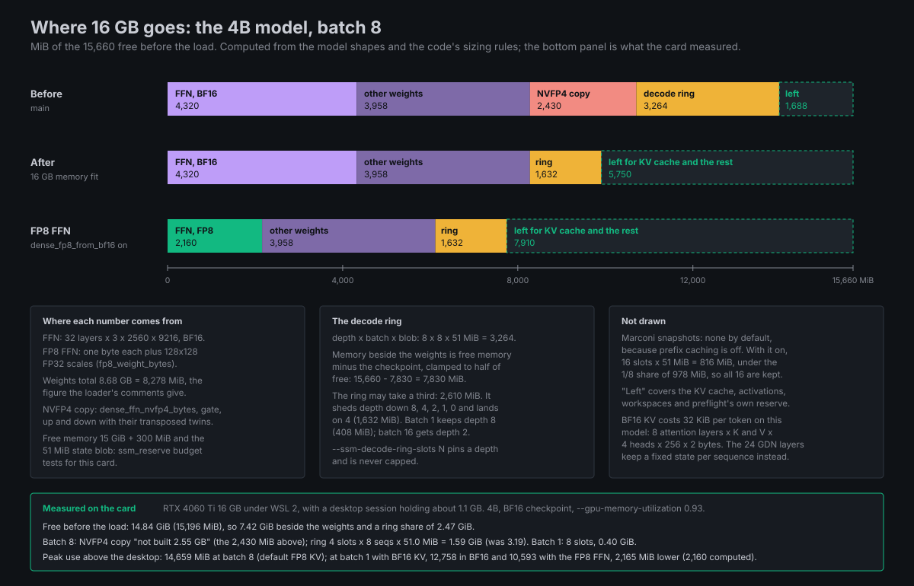

# From GB10 to Ada: 381 aggregate tokens per second on a 16 GB RTX 4060 Ti

_Porting Atlas to a consumer NVIDIA GPU, building low-bit kernels for it, and measuring eight-stream inference on Qwen3.5-4B. The 381 tokens per second is an opt-in int4 and speculative-decoding configuration whose output measurably differs from BF16._

By Josef Long

Atlas began with a roomy hardware target: NVIDIA's GB10, with 120 GB of unified memory. I wanted to know what it would take to make the same inference engine run usefully on an RTX 4060 Ti with 16 GB of VRAM, and how far the design could be pushed once it did.

The result was more than a port. On Qwen3.5-4B, an opt-in int4 and speculative-decoding stack reached **381 output tokens per second in total across eight concurrent requests**, and 98 tokens per second for a single request. Those are screening measurements, and the int4 path changes the model's output: it is not the default, and I have not shown that it is quality-equivalent to BF16. Separately, a precision-preserving change to the BF16 path made prompt processing **4.6 times faster (794 to 3,684 tokens per second)** against Atlas's previous BF16 dispatch.

The story I find more interesting is how it got there: removing hard architecture blockers, reclaiming VRAM, replacing a slow dispatch, trying FP8 and int4 execution and speculation, and finding out with a profiler that the GPU was already about 95 percent busy, which ruled out several optimizations that looked attractive.

This is the short version. The long one, with every table, kernel detail, command and caveat, is the [full technical report](consumer-nvidia-ada.md), and the labeled per-lane results (measured, experimental, rejected, known limitation) are in the [status table](consumer-gpu-status.md).

## The challenge

GB10 makes some choices easy. With 120 GB of memory, a 27B model, a deep rollback ring and a large prefix-cache pool all fit at once, and nobody counts megabytes. A 16 GB card makes you count every one.

| | GB10 | RTX 4060 Ti 16 GB |
|---|---|---|
| Memory | 120 GB unified | 16 GB GDDR6 |
| Bandwidth | 273 GB/s | 288 GB/s |
| Streaming multiprocessors | 48 | 34 |
| Architecture | Blackwell | Ada Lovelace (`sm_89`) |
| FP4 tensor path, TMA, raised static shared memory | yes | no, no, no |

Bandwidth barely changes, so a model that fits decodes at a familiar speed. Capacity drops to about a seventh, compute shrinks, and the older architecture lacks three things GB10 kernels lean on. The payoff is reach: anyone with a 40-series card, and Ada data-center parts such as the L4 that share the `sm_89` architecture, could run the same serving stack locally.

The models are Qwen3.5-4B and 0.8B, served through the `holo-3.1-4b` and `holo-3.1-0.8b` kernel targets. Everything in this article that has a speed on it is the 4B unless a column says 0.8B. The 27B has not run on this card.

## What I measured

How to read these numbers: **C=1** is one user alone, in tokens per second for that user. **C=8** is eight users at once, and the number is the **total** across all eight; each gets about an eighth. All rates are generated output tokens per second.

**Eight-stream throughput on the 4B**, one server with eight slots, 512 generated tokens per request, BF16 KV cache and BF16 LM head, the same fixed-length-request switch on for every setup (more on that switch below):

| Users | BF16 (default) | FP8 FFN (opt-in) | int4 stack (opt-in, **lossy**) |
|---|---|---|---|
| 1 | 29 | 40 | 98 |
| 8, total | 195 (about 24 each) | 222 (about 28 each) | 381 (about 48 each) |

**Prompt processing, same prompt, one request.** A 3,921-token prompt on the 4B: 794 tokens per second before, 3,684 after. The "before" is Atlas's own previous BF16 dispatch, which sent the dense feed-forward network through a hand-written tensor-core GEMM that is slow on this card. The "after" routes it through cuBLASLt. This is not a comparison with llama.cpp or any other engine, it is not about decode, and it changes no numerics class: BF16 in, FP32 accumulate. It is the one speed change that is on by default for Ada.

**Long context.** With an FP8 KV cache the 4B served and recalled a needle placed in a 159,807-token prompt (112 seconds, 15.0 of 16 GB in use). A 261,632-token prompt failed with an untriaged "Inference cancelled" error. One needle test says the server can hold and retrieve at that length. It does not say the model reasons well there, and it is not a 262K-capable serve.

**Qualifications that belong next to the numbers:**

- The 381 is the int4 stack with MTP at one draft. Against BF16 its mean top-20 KL is 0.0337 (FP8 FFN: 0.0029), only 14.4 percent of tokens agree before the first difference, and 1 of 24 test prompts never diverges. I have not run it on a real task.
- These are screening runs: two repetitions per cell, not the longer confirm runs I originally planned.
- The only other engine I measured is llama.cpp in BF16, on separate days ([What the numbers do not prove](#what-the-numbers-do-not-prove)).

## What this work contributes

This list says what the work adds, not that every technique is new. The techniques are known. The value is the specific Ada adaptation, the measured interactions on one constrained card, and a bounded, reproducible record.

- A narrowly scoped Ada (`sm_89`) target for Atlas that handles the shared-memory, TMA and FP4 incompatibilities while keeping the inherited GB10 sources unchanged.
- Budgeted model residency and recurrent-state accounting that make a 16 GB deployment workable and let FP8 and MTP configurations pass a preflight that used to refuse them.
- Ada-specific FP8 and int4 execution plus speculation and verification experiments, showing how throughput, concurrency and numerical fidelity interact on one consumer GPU.
- A measured account of what helps (cuBLASLt BF16 prefill, low-bit decode, selected verification kernels) next to the negative results (CUDA Graph changes, fusion, an FP8 LM head).
- A bounded benchmark record that documents its own method corrections and locates the hot kernels with GPU profiling.

## Making GB10 kernels run on Ada

Atlas's GB10 kernels are written to an SM80-class floor, so most compile for Ada unchanged. Three things do not.

1. **Static shared memory.** The prefill attention kernels declare their tiles as static `__shared__` arrays: 70,400 and 90,112 bytes in the main kernel. `ptxas` allows more than 48 KiB of static shared memory only for architecture strings with an `a` suffix such as `sm_90a`. There is no `sm_89a`, so it refuses with "uses too much shared data". On Ada this hits 22 prefill modules and 42 entry points. The same bytes are legal as *dynamic* shared memory, which `sm_89` lets a block opt into up to 101,376 bytes.
2. **TMA.** One opt-in Gated DeltaNet state kernel uses `cp.async.bulk.tensor` and `mbarrier.arrive.expect_tx`, which need `sm_90`.
3. **FP4.** The MoE GEMM that the holo targets link has a W4A4 tail built on an FP4 convert and a block-scaled MMA, neither of which exists on Ada.

I did not find these one failed launch at a time. The first piece of the work is [`scripts/check_arch_portability.py`](../../scripts/check_arch_portability.py), a probe that answers one question on any machine with a CUDA toolkit: would this kernel tree assemble for architecture X? It enumerates every `.cu` file the build would compile for a target, merges the same three flag layers the build merges, and runs `nvcc --ptx` followed by `ptxas`. Pointed at the GB10 tree for `sm_89` it reports 534 unique compiles, 474 passing and 60 failing in `ptxas`, all in the three classes above. Pointed at the Ada tree it reports 223 of 223 passing. It is a necessary check, not a sufficient one: it finds unknown instructions and resource overflows, and says nothing about launch bounds, numerics or speed.

### How the shared-memory fix works

The goal was to keep the same tiles, the same bytes and the same kernel bodies, and change only what kind of shared memory they live in. Each kernel's static arrays move into a struct with the same members and order, laid over one dynamic buffer, with the old array names bound to its members by reference so the kernel body does not change by a line.

The part I like best is who owns the launch size. Dynamic shared memory is sized by the launch, and the prefill dispatch sites pass no size. Teaching each of them a per-target tile size would put a second copy of every kernel's layout on the host, where it could drift. Instead, each converted kernel exports its own size as a device symbol, `<entry>_dyn_smem_bytes`, set from `sizeof` of its own tile struct, with a `static_assert` that it fits an Ada block. When the registry resolves an entry point it looks for that symbol in the same module. If it is absent, which is the normal case on every other target, there is no floor. If present, the launch is raised to at least that size and the existing path calls `cuFuncSetAttribute`.

So the size lives in exactly one place, no dispatch site changes, and no other target's launches change. It also fails closed: a symbol that exists but cannot be read, or is not 4 bytes, is an error at resolution, never a silent zero, because a dynamic-tile kernel launched with no dynamic memory reads shared memory out of bounds instead of just running slowly. Across the 42 converted entry points the floors range from 66,560 to 90,112 bytes.

### Keeping the blast radius small

`kernels/ada` mirrors `kernels/gb10` with relative symlinks, the pattern Hopper and B200 already use: 253 files, 200 of them symlinks and 53 real. Five real files override gb10 sources (four prefill sources and the TMA kernel); the rest are Ada-only additions. Nothing in `kernels/gb10/common` changes, so no other target's PTX moves. A shared check refuses an undeclared real file, and the inherited-target tests hold Ada to the same mirror assertions as Hopper and B200. The cost is that a later gb10 edit to one of the five overridden files does not reach Ada until someone copies it over, and each real file's header says so.

## Making the model fit

With the kernels compiling, the next problem was memory. For the 4B at the default batch of 8, the free 15,660 MiB left only 1,688 MiB for the KV cache, activations and workspaces, which cannot serve anything useful. Two things were eating the card.

**A copy nobody reads.** For plain BF16 checkpoints, the loader built the BF16 feed-forward weights and also quantized them to NVFP4 as a "fallback". I read every entry point of the layer and found nothing that can reach that fallback at any batch size or speculative setting. By the loader's own formula it costs 2,430 MiB on the 4B. The layer is now built without it, so a missed path would hit a null pointer instead of reading stale data. An existing escape hatch brings the copy back.

**Two regions sized for 120 GB.** Hybrid models keep snapshot regions of recurrent state. The decode-rollback ring was 3,264 MiB at the defaults, and its auto-fit measured free memory before the weights loaded. A budget now caps the ring at a third of what sits beside the weights, shedding depth from 8 down. At batch 8 on this card the ring goes from 3.19 GB to 1.59 GB, and the card's preflight log reports exactly that. Concurrency is kept; only depth is given up. The divisors were chosen so GB10 does not change in practice.

The result is about 5,750 MiB for the KV cache and workspaces (7,910 MiB with an FP8 feed-forward network), enough to serve, and enough for MTP speculation to pass the memory preflight, which it did not before.

## Making it fast

Single-stream decode is bandwidth-bound: a weight read once per token against 288 GB/s. Prefill is compute-bound. That split explains which optimizations helped where.

**cuBLASLt for the BF16 prefill.** The 4.6 times above. The previous hand-written GEMM spent at least 3.9 seconds on the feed-forward network of a 3,921-token prompt. Moving that one path to cuBLASLt took the 4B's time to first token from 4.94 to 1.07 seconds. The Ada target now declares it as a default.

**FP8 on Ada.** Weights are converted from BF16 to block-scaled E4M3 at load, off by default. Decode uses a GEMV that converts FP8 in registers; prefill uses a W8A8 GEMM on FP8 tensor cores that reaches 61 to 72 TFLOP/s on the four feed-forward shapes against 44 to 52 for the GB10 kernel on the same card. Both are bit-identical to the GB10 kernels they replace. For one user the 4B decodes 1.34 times faster with an FP8 feed-forward network (28.9 to 38.7 tokens per second), frees 2.1 GB, and has a mean KL of about 0.002 against BF16. I used FP32 accumulation even though FP16 accumulation runs at twice the rate on GeForce Ada, because a block-scaled FP8 product can reach 448 times 448, about three times FP16's largest finite value.

**Speculation, and why concurrency changes everything.** MTP speculative decoding lifts one user to 49.7 tokens per second on the FP8 4B. At eight users, with nothing else changed, it lost: 156.8 total with one draft against 197.4 without it. My read, which I did not measure, is that speculation trades spare compute for fewer weight passes, and eight users leave less compute to spare. Two things made it pay again: a width policy that remembers each batch width, and batched verify kernels for the Gated DeltaNet and LM-head projections. With them, one-draft MTP went from 164 to 196 total at eight users in the row screen.

**Int4 and the stack.** The int4 stack quantizes the feed-forward, Gated DeltaNet and attention projections to 4 bits and adds MTP with one draft and the width policy. It is the fastest thing I measured: 2.45 times the FP8 feed-forward network for one user and 1.7 times at eight. It is also the one that changes the output, as above.

**Tensor-core pieces.** A 16-row tensor-core FP8 feed-forward kernel is faster in isolation (a flat 91 to 103 microseconds for 1 to 16 rows against 158 to 166 for the old batched GEMV at 8 rows), but I screened it twice in serving and got between about 3 and 15 percent at eight users, with one rerun disturbed. A tensor-core Gated DeltaNet prefill cut time to first token on a different, 5,349-token prompt from 1,262 to 1,097 ms, one run per setting and a small numerics change. I keep those separate from the 3,921-token table because the prompts differ.

## What the profiling overturned

I profiled the two fast setups with Nsight Systems at eight streams. The GPU was busy 95.6 percent of the time on the int4 stack and 94.3 percent on the FP8-coverage setup, with under 5 percent idle between kernels. That is the most useful single measurement in the project, because it says host overhead and graph topology are not where the remaining speed is.

On the int4 stack, GPU time splits roughly:

| Kernel family | Share of GPU time |
|---|---|
| The three 4-bit GEMVs | about 44% |
| A BF16 batched GEMV | 21% |
| Gated DeltaNet recurrent decode | 13% (about 285,000 launches of 15 µs in 35 s) |
| Paged decode attention | 9% |

About 1.9 million kernels launched in those 35 seconds, many of 1 to 7 microseconds. The 21 percent BF16 GEMV is *suspected* to be the BF16 LM head, which reads about 1.27 GB per step, but I have not confirmed that attribution.

The profile explains the negative results below. CUDA Graph topology changes were flat, which supports putting the next effort into kernels, not that graphs can never help. I would not sum isolated kernel speedups to predict an end-to-end gain, and I did not.

## What did not work

Negative results are part of the record, so they stay in the article.

- **CUDA Graph topology classes, writing the recurrent state only on accepted drafts, and a graphed MTP draft chain:** all flat. The oracles for the second are bit-exact; the serve is flat.
- **Batched recurrent state, a batched Gated DeltaNet GEMM, split-K attention:** inside the noise at short context.
- **A fused RMSNorm and FP8 quantize kernel for prompt reading:** identical output (24 of 24 prompts), no speed change (882 to 885 ms at 3,878 tokens).
- **An FP8 LM head:** 10 percent faster for one user, 27 percent slower in total for eight (208.5 to 152.1 tokens per second), and 0.6 GB more VRAM.
- **A "Sharp" chat template** meant to improve answers: on a 60-question MMLU-Pro pilot it scored 38.3 percent against 53.3 for the stock template. Small sample, no sign of a benefit.
- **Block-sparse prefill** cut time to first token at 32K by 5.9 percent (18,155 to 17,077 ms), but its attention is approximate, so it stays off.

I also found a failure I do not fully explain. A batched FP8 verify GEMV faulted with illegal addresses at 3 to 8 rows. Indexing the activations with a 32-bit word index fixed it, the author's microtests pass, `compute-sanitizer` reports no errors, and a scan of 216 PTX files found no other place with the same pattern. The evidence points to a code-generation problem in CUDA 13.3's `ptxas`, but I have not built a minimal independent reproducer or compared the machine code, so I call it a suspected compiler issue with a verified workaround.

## What the numbers do not prove

**The fairness rerun.** My first final run gave the fixed-length-request switch (`AVAROK_MIN_TOKENS_GPU_ARGMAX`) to the int4 stack but not to the setups it was compared against. That switch matters only for benchmarks like mine: a greedy request that sets `min_tokens` otherwise copies the logits to the host on every decode step, which ordinary requests never do. The first run therefore showed 380 against 201 for FP8 at eight users. With the switch on every arm, the references rose (BF16 to 195, FP8 to 222), the stack is 381, and the gap is 1.7 times, not 1.9. About 5 to 10 percent of the first run's lead was the benchmark method. The numbers in this article are the fair rerun.

**What is still not established:**

- **Task-level quality of the int4 stack.** Only KL, top-1 agreement and the coherence suite exist. The suite has four checks that fail the same way in every build, and passing it is not task accuracy.
- **A fair FP8-coverage speedup.** The FP8-coverage plus tensor-core setup measured 290 against 208 for the FP8 serve in the same screen, but only its arm had the fixed-length switch, so the +39.5 percent is not like for like. A like-for-like figure is not measured; my estimate of about +24 percent is an estimate.
- **Matched competitors.** BF16 llama.cpp on this card, measured on a different day with Vulkan, got 2,752 to 2,794 tokens per second of prefill and 28.3 of decode on the 4B, against Atlas's 3,684 and 28.6. That says prompt reading is ahead and decode is level within noise. I did not measure a quantized llama.cpp or any other engine at 4 bits, so nothing here says Atlas is faster than another engine at low precision.
- **The 27B, other Ada parts, and long-context reasoning.** None measured. The GGUF 27B needs about 29.5 GiB once loaded; I chose the route (EXL3 at 3.00 bits per weight) but have not written the loader.
- **Repeats.** Every November number is a screen. Nothing has had the full ABBA confirm run, and about 70 minutes per arm is why.
- **A memory-safety pass over long prompts.** `compute-sanitizer` could not run under WSL 2 in the form I wanted.

## What ships, what stays experimental, what comes next

**Behavior changes for everyone:** the Ada target itself; the BF16 feed-forward prefill through cuBLASLt on Ada; and the two memory-fit fixes (the unused NVFP4 copy, the budgeted rollback ring), which are tuned so GB10 does not change in practice. Every speed row beyond that, including FP8, int4, MTP verify kernels, the width policy and the tensor-core kernels, is **opt-in**, off on every target, with an environment override and a boot-line marker. The pull request flips no other default. The branch also adds a llama.cpp-compatible API surface, and one security-relevant fix that comes with it: the auth, rate-limit and GPU-fault checks decide by request path and were written when every protected route lived under `/v1/`, so without a change `--require-auth` would have left the new root-level `/completion` route open to anyone. One shared path list now feeds all three checks. The API work is documented in the technical report and kept out of this narrative.

**Known open problems:** on this hybrid model a prefix-cache hit is only useful if a recurrent-state snapshot exists at the same boundary, and often there is none, so a multi-turn test recomputed every prompt; the host-memory KV tier stored blocks but restored none in its tests; the two long-prompt failures at 95,000 tokens (BF16 KV) and 261,632 (FP8 KV) are untriaged; and LFM3's shape check is fixed but I have not served it on the card yet.

**Where the next speed is.** The profile points at the kernels: a batched low-bit LM-head kernel for the 21 percent BF16 GEMV, the 4-bit GEMVs, and fusing the Gated DeltaNet decode. I aimed for 500 tokens per second in total at eight users and got 381, and that was the lossy setup.

**Reproducing it.** The opt-in recipes are environment variables on a release build of the branch; the boot line marks each one you set with `(env)`. The recipes, the exact serve flags, the hardware and toolchain versions, and the checks to run on and off the card are in the [full technical report](consumer-nvidia-ada.md) (Appendix A has the commands and the checks to run on and off the card).
