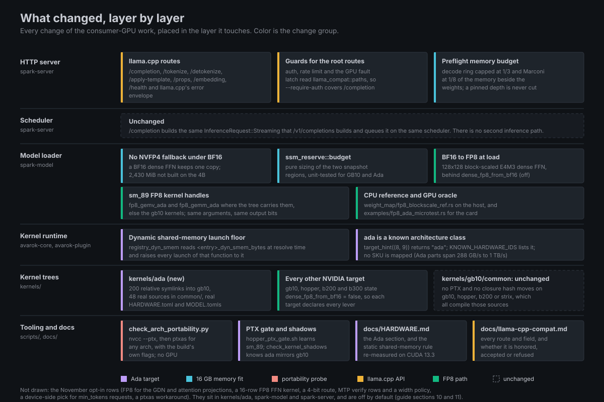
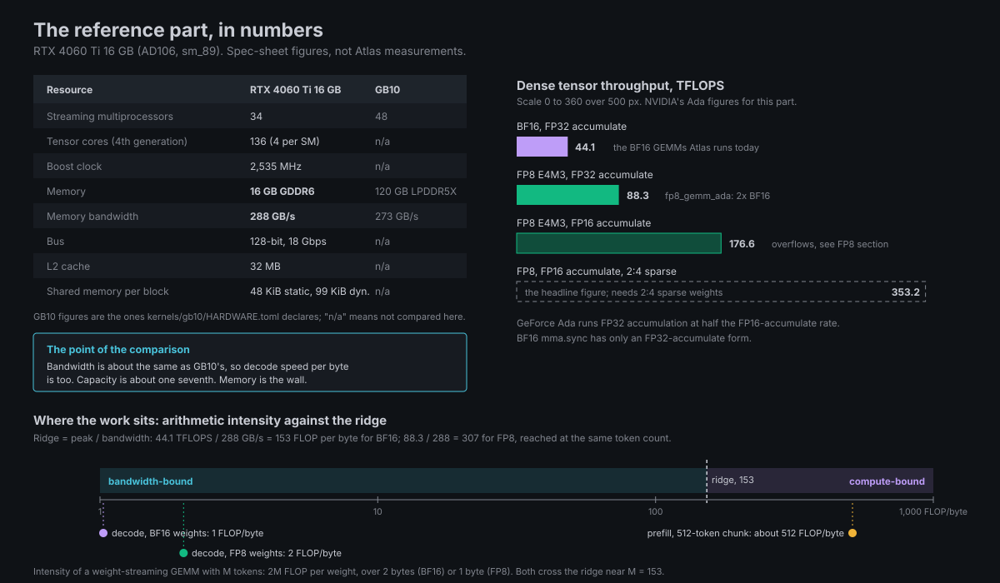
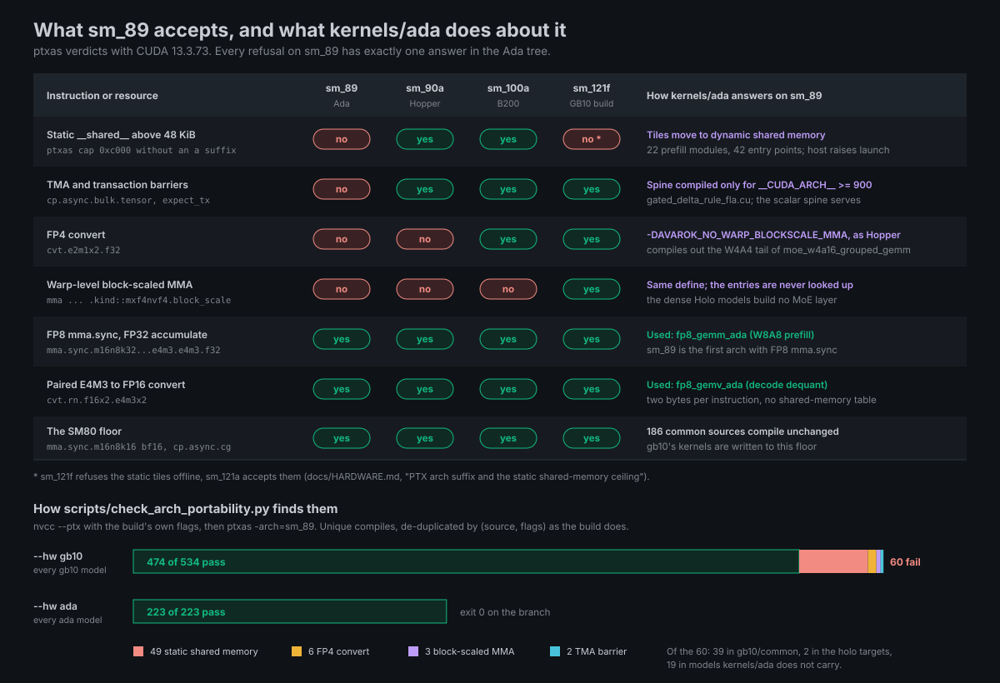
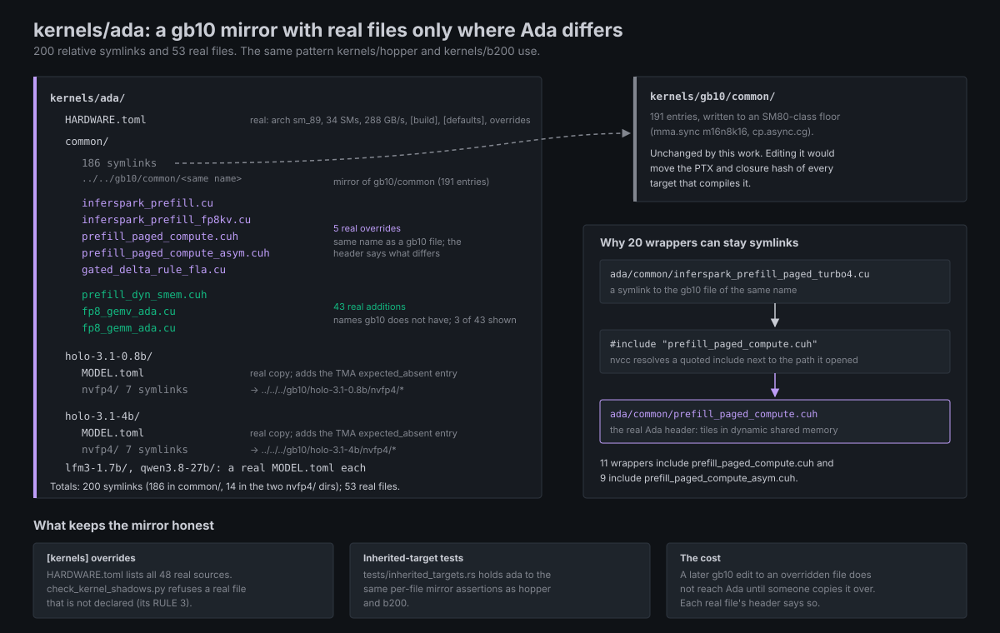
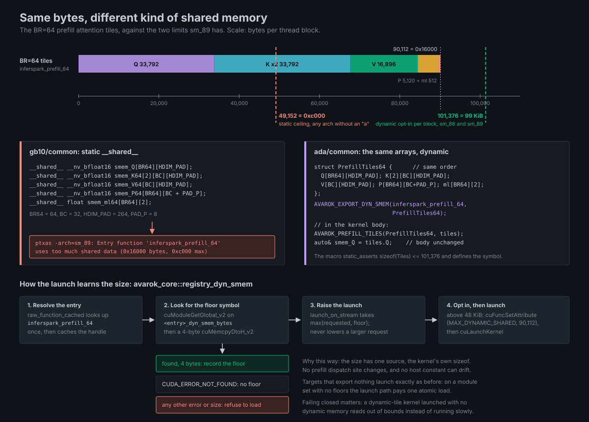
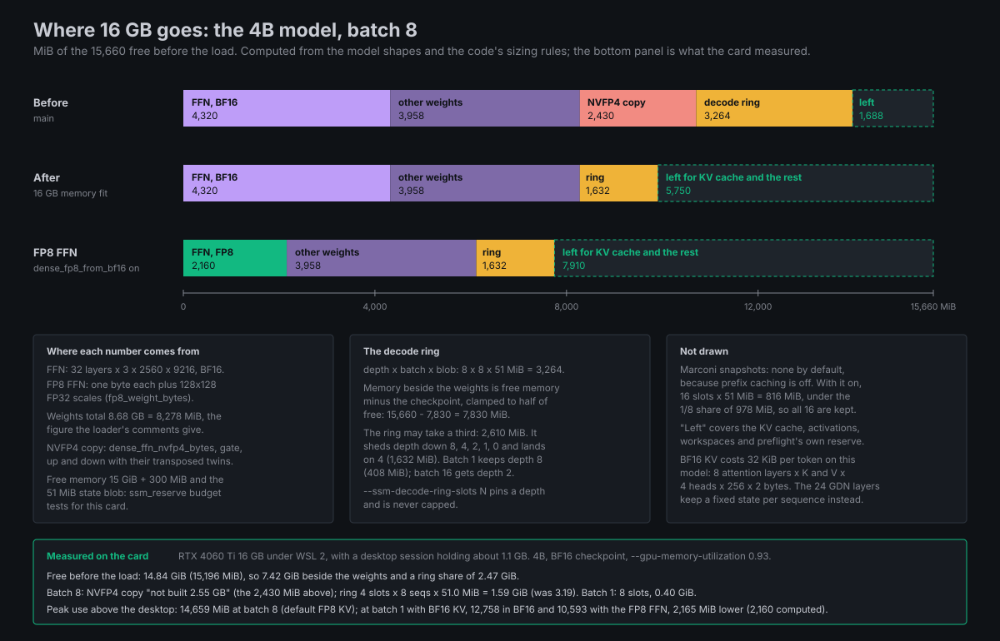
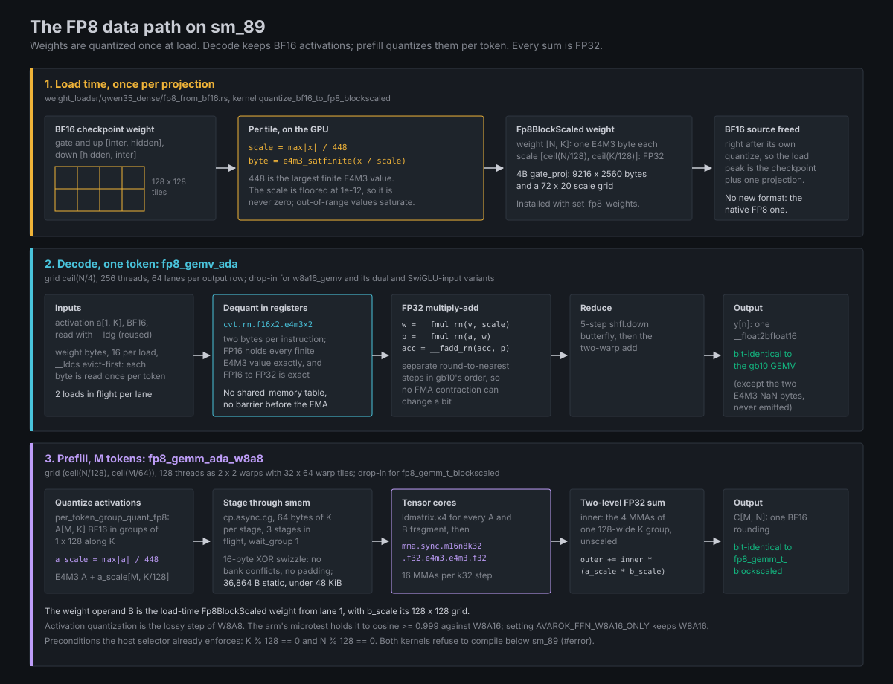
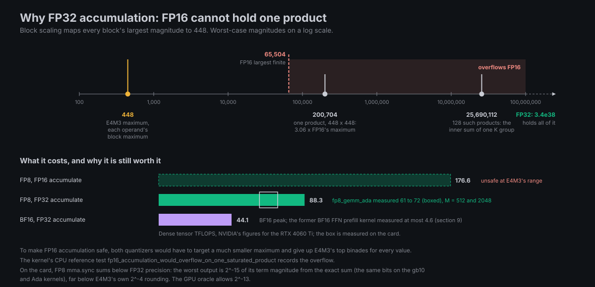
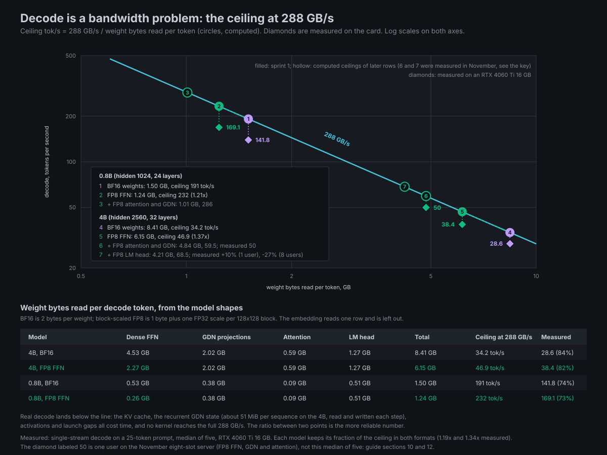
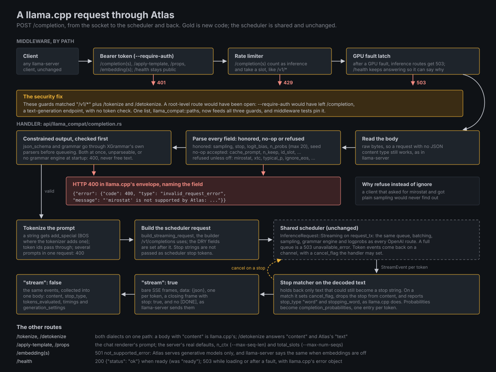

<!-- SPDX-License-Identifier: AGPL-3.0-only -->

# Atlas Ada (sm_89) Port: Implementation, Benchmarks, Limitations, and Reproduction Notes

_How Atlas goes from GB10 to a 16 GB consumer card: what breaks on sm_89, what changes in each layer, and how to check the result with and without the card._

By Josef Long

**Where to start.**
This is the full technical report. The short overview is [consumer-gpu-overview.md](consumer-gpu-overview.md).
Per-lane status and the labeled results are in [consumer-gpu-status.md](consumer-gpu-status.md), and Appendix A has the reproduction commands.

**Abstract.** I ported Atlas, which was built for GB10, to a 16 GB RTX 4060 Ti (Ada, `sm_89`). Three architecture walls stood in the way: static shared memory above 48 KiB, no TMA and no FP4. I fixed them with dynamic shared memory whose size the kernel owns, by dropping an unused NVFP4 weight copy, and by budgeting the recurrent-state snapshot regions. For speed, cuBLASLt BF16 prefill is the one new default, and opt-in rows add FP8, int4 and MTP verify. On the 4B, BF16 prefill went from 794 to 3,684 tok/s against Atlas's previous BF16 dispatch. With eight users the totals are 195 tok/s (BF16), 222 (FP8 FFN) and 381 (the lossy opt-in int4 stack); for one user they are 29, 40 and 98. The limits: int4 task accuracy is unmeasured, the 27B has not run, and I have no matched quantized comparison with another engine.

**Contents**

- [Results at a glance](#results-at-a-glance)
- [What this work contributes](#what-this-work-contributes)
- [What changed](#what-changed)
- [1. Why consumer cards](#1-why-consumer-cards)
- [2. The card, in numbers](#2-the-card-in-numbers)
- [3. What broke on sm_89, and why](#3-what-broke-on-sm_89-and-why)
- [4. The Ada target layout](#4-the-ada-target-layout)
- [5. The shared-memory fix, step by step](#5-the-shared-memory-fix-step-by-step)
- [6. Fitting 16 GB](#6-fitting-16-gb)
- [7. FP8 on Ada](#7-fp8-on-ada)
- [8. Speaking llama.cpp's API](#8-speaking-llamacpps-api)
- [9. Results on the card](#9-results-on-the-card)
- [10. Results with several users (November 12 to 14)](#10-results-with-several-users-november-12-to-14)
- [11. Opt-in recipes](#11-opt-in-recipes)
- [12. What did not work, and what is not finished](#12-what-did-not-work-and-what-is-not-finished)
- [13. Limits and next steps](#13-limits-and-next-steps)
- [Appendix A: Reproducing the results](#appendix-a-reproducing-the-results)
- [Appendix B: the change set](#appendix-b-the-change-set)

Atlas was built on GB10: 120 GB of unified memory, one box, one model target at a time. This guide brings it to a consumer graphics card, with the RTX 4060 Ti 16 GB as the reference part. It covers what broke, why it broke, what changed in each layer of Atlas, and how to check the result with and without the card.

**Atlas now runs on the card.** Every Ada kernel assembles for `sm_89`, the host-side changes are unit-tested on the mock backend, and the whole path has served on an RTX 4060 Ti 16 GB: the kernel audit, the FP8 kernel oracle, BF16 and FP8 serves of both models, and the 16 GB memory checks. The headline numbers are below, and section 9 has the full measurements and the exact setup. Every number in this guide is one of three things, and the text says which each time: a figure from NVIDIA's spec sheet, a value computed from the model shapes and the code's own sizing rules, or a measurement from that run. A second round of runs, in November, measured the card with up to eight users at once and screened every optimization on this branch the same way; section 10 has those results, section 11 the opt-in recipes, and section 12 what did not work.

## Results at a glance

Everything here was measured on one RTX 4060 Ti 16 GB under WSL 2, on the 4B (the Qwen3.5-4B BF16 checkpoint, served through the `holo-3.1-4b` target) unless a column says 0.8B. There are two sets of runs, and each table says which it comes from:

- **One user, one request at a time** (section 9). Prompt reading and decode, median of five runs.
- **Several users at once** (section 10). One server set up for eight users, measured with 1, 2, 4 and 8 users sending at the same time. **C=1** is one user alone, in tokens per second for that user. **C=8** is eight users at once, and the number is the **total** across all eight; one user gets about an eighth of it.

**One user** (this branch's defaults and the optional FP8 FFN; 3,921-token prompt for prefill, 25-token prompt for decode, median of five):

| Measurement | 0.8B, BF16 | 0.8B, FP8 FFN | 4B, BF16 | 4B, FP8 FFN | 4B, FP8 FFN + MTP |
|---|---|---|---|---|---|
| Prefill tok/s, 3,921-token prompt | 13,798 | 13,220 to 14,538 (two runs) | 3,684 | 4,135 | 3,400 |
| Time to first token, same prompt | 284 ms | 270 to 297 ms | 1,064 ms | 948 ms | 1,153 ms |
| Decode tok/s, single stream, short prompt | 141.8 | 169.1 | 28.6 | 38.4 | 49.7 |
| Peak VRAM (MiB), batch 1 | 4,676 | 4,408 | 13,596 | 11,492 | 11,753 |
| Mean KL over top-20 logprobs, against BF16 | n/a | 0.0021 | n/a | 0.0016 | same tokens as FP8 FFN (KL 0.00005 against it) |

Both models fit and serve on a 16 GB card.

**Several users, 4B, total tok/s across all users** (one server with 8 slots, BF16 KV cache, BF16 LM head, fixed-length streams of 512 generated tokens, `mintok` on every arm; the fair final run of 2026-11-14):

| Users | BF16 | FP8 FFN (opt-in) | int4 stack (opt-in, **lossy**) |
|---|---|---|---|
| 1 | 29 | 40 | 98 |
| 2 | 56 | 77 | 185 |
| 4 | 107 | 143 | 294 |
| 8 | 195 (about 24 per user) | 222 (about 28 per user) | 381 (about 48 per user) |

What carries these numbers:

- **The BF16 default.** On Ada the BF16 dense FFN now prefills through cuBLASLt (`[defaults] ffn_bf16_cublas_prefill`). That made the 4B read a 3,921-token prompt 4.6x faster than Atlas's previous BF16 dispatch did (794 to 3,684 tok/s), and the 0.8B 1.7x faster. That figure is prefill only, not decode, and not a comparison with another engine. Total decode at two to eight streams was measured separately, at 2.0 to 2.3x the previous dispatch. The numerics class is the same and there is no new memory. It is the only default this branch changes on Ada.
- **The optional FP8 dense FFN** (`AVAROK_DENSE_FP8_FROM_BF16=1`) speeds single-stream decode up 1.19x on the 0.8B and 1.34x on the 4B, frees 2.1 GB on the 4B, and holds a mean KL of about 0.002 against BF16. At 8 users its gain over BF16 is small (222 against 195 total).
- **The tensor-core GDN prefill** (`AVAROK_GDN_PREFILL_TC=1`, opt-in) speeds up prompt reading, not decode. On the FP8 FFN route with FP8 KV and a prompt of about 5,349 tokens, time to first token went from 1,262 to 1,097 ms (-13.0 percent), about 4,238 to 4,876 prompt tok/s (+15 percent), one run per arm, mean KL 0.00089 against the row off. That prompt is longer than the 3,921-token prompt in the table above, and the 3,921-token case was not measured with this row, so the two figures are not comparable.
- **MTP speculative decoding** (`--speculative`) lifts one user on the 4B to 49.7 tok/s with the FP8 FFN. With several users it does not help on its own: at 8 users FP8 with MTP measured 156.8 tok/s total against 197.4 without it. The verify rows in section 10 are what make it pay at 8 users.
- **The best FP8-coverage setup**, `fp8covtc` (FP8 for the FFN, GDN and attention projections, the tensor-core FFN kernel and `mintok`), measured 290 tok/s total at 8 users against 208 for the FP8 FFN serve in the same screen, and 49 against 39 for one user. That comparison is not like for like: the row arm had `mintok` and the base did not. A like-for-like figure is **not measured**; my estimate is about +24 percent instead of +39.5 percent, and it is only an estimate. Its mean KL against that FP8 FFN serve is 0.0018; its KL against BF16 was not measured. It ran in a row screen (256-token streams), not in the final run, so it is not in the table above.
- **The int4 stack is lossy and opt-in.** It quantizes the FFN, GDN and attention projections to 4 bits and adds MTP with one draft. Against BF16 its mean KL is 0.0337 (FP8: 0.0029), its top-1 token agreement is 14.4 percent, and 1 of 24 test prompts never diverges (FP8: 6 of 24). Its accuracy on real tasks was not measured. Use it only where that trade is acceptable.

**Read the 381 as follows:** it is the total output tokens per second across eight concurrent requests (about 48 per request), on Qwen3.5-4B, with an opt-in int4 stack that changes the model's output (KL 0.0337 against BF16, accuracy on real tasks not measured). It is a screening result, not a record, and not a comparison with another engine.

Three things to know before quoting any of this:

- **Nothing from the November work is on by default, and this PR flips no default.** Every November row stays opt-in, with recipes in section 11.
- **The several-user runs send fixed-length requests** (`min_tokens` equal to `max_tokens`). On such a request every decode step copies the logits to the host for sampling; ordinary requests never pay that. The `mintok` row removes it, so the final run gives `mintok` to every arm, and the table above compares like with like. A first run gave it only to the stack, which flattered the stack by about 5 to 10 percent (section 10.4).
- **The 27B has not run on this card** (section 12), and the only comparison with another engine is BF16 llama.cpp (section 10). No quantized llama.cpp or other engine was measured, so nothing here says Atlas is faster at 4 bits.

The FP8 route stays off by default until the checks listed in section 9 are done.

## What this work contributes

This list says what the work adds, not that every technique is new. The techniques are known; the value is the specific Ada adaptation, the measured interactions on one constrained card, and a bounded, reproducible record.

- A narrowly scoped Ada (`sm_89`) target for Atlas that handles the architecture-specific shared-memory, TMA and FP4 incompatibilities while keeping the inherited GB10 sources unchanged.
- Budgeted model residency and recurrent-state accounting that make a 16 GB deployment workable and let FP8 and MTP configurations pass a preflight that used to refuse them.
- Ada-specific FP8 and int4 execution plus speculation and verification experiments, showing how throughput, concurrency and numerical fidelity interact on one consumer GPU.
- A measured account of what helps (cuBLASLt BF16 prefill, low-bit decode, selected verification kernels) next to the negative results (CUDA Graph changes, fusion, an FP8 LM head).
- A bounded benchmark record that documents its own method corrections and locates the hot kernels with GPU profiling.

## What changed

The work comes in seven parts, and none of them touches `kernels/gb10/common`, the kernel sources every NVIDIA target inherits. No other target's PTX moves. The November opt-in rows do add code to `spark-model` and `spark-server` (the MTP width policy and the device-side greedy pick live there), and the `HARDWARE.toml` files of four other targets (b200, b300, gb10, hopper) gain default-off declarations of the new rows, additions only, so every target states every lever.

| Part | What it does | Where it lives |
|---|---|---|
| Ada target | A `kernels/ada` tree for `sm_89`, three kernel fixes and one host change | `kernels/ada/`, `avarok-core`, `avarok-plugin` |
| 16 GB fit | Stops building a weight copy nothing reads, and caps two snapshot regions by a memory budget | `spark-model`, `spark-server` preflight |
| Portability probe | Tells you whether a kernel tree assembles for an arch, on any machine with a CUDA toolkit | `scripts/check_arch_portability.py` |
| llama.cpp API | `/completion`, `/tokenize`, `/props` and the rest, so llama.cpp clients work unchanged | `spark-server/src/api/llama_compat/` |
| FP8 path | Load-time BF16 to FP8 for the dense FFN, with two `sm_89` kernels, off by default | `kernels/ada/common/`, `spark-model` |
| Ada serving | cuBLASLt for the BF16 dense-FFN prefill by default, and a post-load memory audit that lets MTP fit with the FP8 FFN | `kernels/ada/HARDWARE.toml`, `spark-model`, `spark-server` preflight |
| Opt-in rows (November) | FP8 for the GDN and attention projections, a 16-row tensor-core FP8 FFN kernel, a 4-bit route for all three projection groups, MTP verify rows and a width policy, the device-side greedy pick for requests with a `min_tokens` floor, and a workaround for a suspected CUDA 13.3 `ptxas` code-generation problem. Every row is off by default on every target | `kernels/ada/common/`, `kernels/ada/HARDWARE.toml`, `spark-model`, `spark-server` |

The November rows don't change any default and don't touch `kernels/gb10/common` either; section 10 has what each one measured.



## 1. Why consumer cards

GB10 makes some choices easy. With 120 GB of memory, a 27B model, a deep rollback ring and a large prefix-cache pool all fit at once, and nobody has to count megabytes. A 16 GB card makes you count every one.

The big change is capacity. Memory drops from 120 GB to 16 GB, about a seventh, and anything sized as a constant because it was a rounding error on GB10 can now eat a quarter of the card. Bandwidth barely moves (273 GB/s on GB10, 288 GB/s here), so a model that fits decodes at a familiar speed. Compute drops from 48 SMs to 34, and the arch is older: Ada has FP8 tensor cores, but no FP4, no TMA, and no way to raise the 48 KiB static shared-memory limit. Kernels written for Blackwell trip over all three.

The payoff is reach. Anyone with a 40-series card can run Atlas's serving stack locally, a small team can develop on a cheap box that runs the same engine as its GB10 deployment, and Ada data-center parts such as the L4 share the same `sm_89` arch. The target models are the two dense Holo 3.1 checkpoints, `holo-3.1-0.8b` and `holo-3.1-4b`, single stream.

## 2. The card, in numbers



| Resource | RTX 4060 Ti 16 GB |
|---|---|
| GPU | AD106, compute capability 8.9 (`sm_89`) |
| Streaming multiprocessors | 34 (`sm_count = 34` in HARDWARE.toml) |
| Tensor cores | 136, fourth generation, 4 per SM |
| Boost clock | 2,535 MHz |
| Memory | 16 GB GDDR6, 128-bit bus at 18 Gbps |
| Bandwidth | 288 GB/s (`memory_bandwidth_gbps = 288`) |
| L2 cache | 32 MB |
| Shared memory per block | 48 KiB static, up to 101,376 bytes dynamic with an opt-in |

NVIDIA lists this card at 353 "AI TOPS", which needs unpacking before it means anything for Atlas. 353.2 is FP8 with 2:4 structured sparsity and FP16 accumulation. Atlas's weights are dense, so it doesn't apply. Dense FP8 with FP16 accumulation is half that, 176.6 TFLOPS. GeForce Ada runs the FP32-accumulate form at half the FP16-accumulate rate, so dense FP8 with FP32 accumulation is 88.3 TFLOPS. Dense BF16 with FP32 accumulation, which Atlas's BF16 GEMMs use today, is 44.1. Atlas's FP8 GEMM accumulates in FP32 (section 7 explains why), so the comparison that matters is 88.3 against 44.1. FP8 doubles the tensor rate.

The other number that matters is the ridge point: peak compute over bandwidth. For BF16 that's 44.1 TFLOPS over 288 GB/s, or 153 FLOP per byte. A GEMM that streams weights does 2M FLOP per weight for M tokens, so its intensity is M FLOP per byte with BF16 weights and 2M with FP8. Single-stream decode (M = 1) sits at 1 or 2 FLOP per byte, about 150 times below the ridge, so it's bandwidth-bound and its speed is set by bytes per token. Prefill runs at the chunk size, hundreds of tokens, so it's compute-bound. That split drove the FP8 design: decode gains from smaller weights, and prefill gains only if the math itself gets faster.

## 3. What broke on sm_89, and why

Atlas's gb10 kernels are written to an SM80-class floor (`mma.sync.m16n8k16`, `cp.async.cg`), so most of them compile for Ada unchanged. Three things don't.



The first and biggest is static shared memory. The prefill attention kernels declare their tiles as static `__shared__` arrays: 70,400 bytes for the BR=32 entry and 90,112 bytes for BR=64 in `inferspark_prefill.cu`, with similar sizes in the paged and FP8-KV variants. ptxas allows more than 48 KiB (`0xc000`) of static shared memory only for arch strings with an `a` suffix, like `sm_90a`, `sm_100a` and `sm_121a`. There is no `sm_89a`, so ptxas refuses:

```text
ptxas error : Entry function 'inferspark_prefill_64' uses too much shared
              data (0x16000 bytes, 0xc000 max)
```

This is a rule about the arch string, not the toolchain version. `docs/HARDWARE.md` already recorded it under CUDA 13.0.88, and I re-measured it with 13.3.73: `sm_90a`, `sm_100a`, `sm_103a` and `sm_121a` assemble these tiles, and `sm_80`, `sm_86`, `sm_89`, `sm_90`, `sm_100`, `sm_110`, `sm_120`, `sm_120f`, `sm_121` and `sm_121f` all refuse them. On Ada it hits 22 prefill modules with 42 entry points. The same bytes are legal as dynamic shared memory, which `sm_89` lets a block opt into up to 101,376 bytes, and that's the fix in section 5.

The second is TMA. `gated_delta_rule_fla.cu` carries an opt-in state spine, `gated_delta_rule_chunk_delta_h_tma`, selected with `AVAROK_GDN_TMA=1`. It uses `cp.async.bulk.tensor` and `mbarrier.arrive.expect_tx`, which need `sm_90`:

```text
Feature 'mbarrier.arrive.expect_tx' requires .target sm_90 or higher
```

The third is FP4. The W4A16 MoE GEMM that the holo `nvfp4/` directories link (`moe_w4a16_grouped_gemm.cu`) has a W4A4 tail built on the FP4 convert and the warp-level block-scaled MMA. Ada has no FP4 datapath:

```text
Feature 'cvt.e2m1x2.f32' not supported on .target 'sm_89'
Instruction 'mma with block scale' not supported on .target 'sm_89'
```

Hopper has the same gap and already handles it with a define, which I reused.

### Finding these without a GPU: the portability probe

Finding these one launch failure at a time would be slow, so the first piece of this work is a probe. `scripts/check_arch_portability.py` answers one question on any machine with a CUDA toolkit: would this kernel tree even assemble for arch X?

It enumerates every `.cu` file the build would compile for one hardware target and compiles each the way the build does. It reads the same three flag layers `crates/avarok-kernels/build.rs` reads (`HARDWARE.toml`, `common/KERNEL.toml` and the model's `KERNEL.toml`), merges them by the same rule as `build_flags::merge_extra_flags`, honors `[model] kernel_source` redirects and same-stem shadowing, and de-duplicates jobs by source path and flags. Each job runs `nvcc --ptx -arch=X -O3 <flags> --Werror all-warnings` and then `ptxas -arch=X`. Nothing gets loaded, so no GPU is involved. It exits 0 when everything passes, 1 when anything fails, and 2 when it can't run.

It's a necessary check, not a sufficient one. It finds unknown instructions and resource overflows with the file and line, and says nothing about launch bounds, numerics or speed. Its simplifications (NVIDIA targets only, no Windows `-std=c++17`, `MODEL.toml` read only for `kernel_source`) are listed in its docstring.

Here's what it found with CUDA 13.3.73. Both rows were re-run on the final branch (tip `cf655f62e`): the gb10 run exited 1 with the same counts as the first tree, and the ada run exited 0 with more compiles, because the Ada tree has grown since the first sprint (section 4):

| Run | Unique compiles | Pass | Fail in nvcc | Fail in ptxas |
|---|---|---|---|---|
| `--hw gb10 --arch sm_89` (every gb10 model) | 534 | 474 | 0 | 60 |
| `--hw ada --arch sm_89` (every ada model) | 223 | 223 | 0 | 0 |

The 60 gb10 failures fall into exactly the three walls: 49 shared-memory overflows, 6 FP4 converts, 3 block-scaled MMAs and 2 TMA barriers. Of those 60, 39 are in `gb10/common` (the 22 prefill modules and `gated_delta_rule_fla.cu`, some under several flag sets), 2 are the holo targets' MoE GEMM, and 19 are in models `kernels/ada` doesn't carry. Every file compiles to PTX for `sm_89` (the nvcc column); only ptxas catches these, which is why the probe runs both.

## 4. The Ada target layout



`kernels/ada` follows the pattern `kernels/hopper` and `kernels/b200` already use: a mirror of `kernels/gb10` made of relative symlinks, with real files only where the target differs. The counts below are from `git ls-tree -r HEAD kernels/ada` on this branch (mode 120000 is a symlink): 253 files, 200 of them symlinks and 53 real.

| Path | Kind | Count |
|---|---|---|
| `kernels/ada/HARDWARE.toml` | real | 1 |
| `kernels/ada/common/*` | symlink to `../../gb10/common/<same name>` | 186 |
| `kernels/ada/common/*` | real, overriding a gb10 file of the same name | 5 |
| `kernels/ada/common/*` | real, a name gb10 doesn't have | 43 |
| `kernels/ada/{holo-3.1-0.8b,holo-3.1-4b,lfm3-1.7b,qwen3.8-27b}/MODEL.toml` | real | 4 |
| `kernels/ada/holo-3.1-{0.8b,4b}/nvfp4/*` | symlink into the gb10 model dir | 14 |

The five overrides are `inferspark_prefill.cu`, `inferspark_prefill_fp8kv.cu`, `prefill_paged_compute.cuh` and `prefill_paged_compute_asym.cuh` for the shared-memory wall, and `gated_delta_rule_fla.cu` for TMA. The 43 additions began as three: `prefill_dyn_smem.cuh` and the two FP8 kernels, `fp8_gemv_ada.cu` and `fp8_gemm_ada.cu`. The rest were added after the first sprint: the kernels of the opt-in rows in section 10 (for example the 16-row FP8 FFN kernel, `fp8_gemm_ada_m16.cu`, and the tensor-core GDN prefill, `gdn_chunk_tc_ada.cu`) and kernels for other routes and models. All 48 real sources are listed in `[kernels] overrides`.

I went with symlinks because 186 of the 234 files in `common/` are gb10's own bytes, so a kernel fix in gb10 reaches Ada the day it lands. Fixing the shared-memory wall inside `gb10/common` instead would have moved the PTX and the closure hash of every target that compiles those sources, and reopened their gates, to solve a problem only Ada has. The tooling already enforces the pattern: `scripts/check_kernel_shadows.py` now knows `ada` mirrors `gb10` and refuses an undeclared real file, and `crates/avarok-kernels/tests/inherited_targets.rs` holds `ada` to the same per-file mirror assertions as Hopper and B200. The price is that a later gb10 edit to one of the five overridden files won't reach Ada until someone copies it over, so each real file's header says what differs from its gb10 original and that it has to be kept in step by hand.

One symlink detail makes the shared-memory fix cheaper than it looks. Twenty paged prefill wrappers (`inferspark_prefill_paged_turbo4.cu` and friends) stay symlinks. Each one does `#include "prefill_paged_compute.cuh"` (11 of them) or `#include "prefill_paged_compute_asym.cuh"` (9). nvcc resolves a quoted include next to the path it opened, which is `kernels/ada/common/`, so the wrappers pick up the real Ada headers without copies of their own.

Three small pieces register the target with the host. `avarok_core::arch::target_hint((8, 9))` returns `"ada"`, so an Ada card is pointed at this tree. `KNOWN_HARDWARE_IDS` lists `ada` as an architecture class with no SKU mapped, because Ada parts run from 288 GB/s to about 1 TB/s and a shared benchmark threshold would merge numbers that aren't comparable. And `HARDWARE.toml` declares `sm_count = 34`, so another Ada card gets a boot warning from `arch_preflight::check_sm_count`, which only affects grid sizing that reads the value.

Every serving default in `[defaults]` is the conservative baseline, the same values as `build_defaults::baseline`. Nothing was carried over from Hopper or GB10 because the hardware looked similar. A row moves only with an A/B measured on an Ada card.

## 5. The shared-memory fix, step by step



The goal was to keep the same tiles, the same bytes and the same kernel bodies, and change only what kind of shared memory they live in.

First, `prefill_dyn_smem.cuh` declares one dynamic buffer:

```c
extern __shared__ __align__(16) unsigned char avarok_prefill_smem[];
```

Then each kernel's static arrays move into a struct with the same members, element types, shapes and order. For the BR=64 entry, with `BR64 = 64`, `BC = 32`, `HDIM_PAD = 264` and `PAD_P = 8`:

```c
struct PrefillTiles64 {
    alignas(16) __nv_bfloat16 Q[BR64][HDIM_PAD];          // 33,792 bytes
    alignas(16) __nv_bfloat16 K[AVAROK_KBUFN][BC][HDIM_PAD]; // 33,792 (two buffers)
    alignas(16) __nv_bfloat16 V[BC][HDIM_PAD];            // 16,896
    alignas(16) __nv_bfloat16 P[BR64][BC + PAD_P];        //  5,120
    alignas(16) float ml[BR64][2];                        //    512
};                                                        // 90,112 total
```

Inside the kernel, the struct is laid over the buffer and the old array names are bound to its members by reference, so the kernel body below doesn't change by a single line:

```c
AVAROK_PREFILL_TILES(PrefillTiles64, tiles);
auto& smem_Q = tiles.Q;
auto& smem_K64 = tiles.K;
// ...
```

Each kernel also exports its own size at file scope:

```c
AVAROK_EXPORT_DYN_SMEM(inferspark_prefill_64, PrefillTiles64);
```

That expands to a `static_assert(sizeof(Tiles) <= 101376)`, so a tile set that outgrows an Ada block fails the compile instead of the launch, and to:

```c
extern "C" __device__ const unsigned int inferspark_prefill_64_dyn_smem_bytes =
    (unsigned int)sizeof(PrefillTiles64);
```

The last piece is the host. Dynamic shared memory is sized by the launch, and the prefill dispatch sites pass no size. Teaching each of them a per-target tile size would put a second copy of every kernel's layout on the host, where it can drift. So `avarok_core::registry_dyn_smem` reads the size from the kernel. When the registry resolves an entry point (`raw_function_cached`), it looks for `<entry>_dyn_smem_bytes` in the same module with `cuModuleGetGlobal_v2`. `CUDA_ERROR_NOT_FOUND` means no floor, which is the normal case on every other target. A symbol that is found is read with a 4-byte `cuMemcpyDtoH_v2` and recorded as that function's floor. Then `launch_on_stream` raises the launch's `shared_mem_bytes` to the floor (it never lowers a larger size a caller already asked for), and the existing code path sees a size above 48 KiB, calls `cuFuncSetAttribute(MAX_DYNAMIC_SHARED_SIZE_BYTES, size)` and launches.

That keeps the size in exactly one place, the kernel's own `sizeof`. No dispatch site changes and no other target's launches change; a module set with no floors pays one atomic load per launch. It also fails closed. A symbol that exists but can't be read, or isn't 4 bytes, is an error at resolution and never a silent zero, which matters because a dynamic-tile kernel launched with no dynamic memory reads shared memory out of bounds rather than just running slowly. `registry.rs` sits just under the repository's 500-line cap for Rust files, so the logic lives in its own module with its own tests.

Across the 42 converted entry points the floors range from 66,560 to 90,112 bytes, all under the 101,376-byte opt-in. I compared the gb10 and Ada trees, both built for `sm_89`: 597 entry points against 596, and the only difference is the TMA spine. For every converted entry, the exported floor equals the old static size minus 0 to 96 bytes of small lookup tables that stay static.

The other two walls were simpler. Ada's copy of `gated_delta_rule_fla.cu` wraps the TMA helpers and the spine in:

```c
#if !defined(__CUDA_ARCH__) || __CUDA_ARCH__ >= 900
```

It's keyed on the arch rather than a hand-set define, so the file is correct for any target that compiles it, and on `sm_90` and later it compiles exactly like the gb10 file. On `sm_89` one entry point disappears. The host looks it up with `try_kernel` and keeps the scalar spine when it's absent, and both holo `MODEL.toml` files declare it in `[expected_absent.gated_delta_rule_fla]` so the startup kernel audit expects the gap. For FP4, `HARDWARE.toml [build]` adds Hopper's `-DAVAROK_NO_WARP_BLOCKSCALE_MMA`, which compiles out the W4A4 tail of the MoE GEMM. The rest of that file is W4A16 at the SM80 floor and compiles fine, and the dense holo models never build an MoE layer, so nothing looks up the two removed entry points. Leaving the file out of the tree would have broken the per-file mirror rule.

## 6. Fitting 16 GB



With the kernels compiling, the next problem was memory. Here's where the 15,660 MiB free on the card goes for the 4B at the default `--max-batch-size 8`. These are computed; the card run confirmed both changes (the end of this section and section 9 have the measured values).

| Region | Before | After | After, FP8 FFN |
|---|---|---|---|
| Dense FFN weights | 4,320 MiB (BF16) | 4,320 MiB (BF16) | 2,160 MiB (FP8) |
| Other weights | 3,958 MiB | 3,958 MiB | 3,958 MiB |
| NVFP4 copy of the FFN | 2,430 MiB | not built | not built |
| Decode-rollback ring | 3,264 MiB | 1,632 MiB | 1,632 MiB |
| Left for KV cache, activations, workspaces | 1,688 MiB | 5,750 MiB | 7,910 MiB |

The FFN is 32 layers of three 2560 x 9216 projections, from `kernels/ada/holo-3.1-4b/MODEL.toml`. The weights total is the 8.68 GB (8,278 MiB) the loader's comments give for the 4B in BF16; the 4B is a vision model (`vision = true` in its MODEL.toml), and 8.41 GB of that is the text model that decode reads every token. The free memory (15 GiB plus 300 MiB) and the 51 MiB per-sequence state blob are the values `ssm_reserve/budget_tests.rs` pins for this card. For scale, BF16 KV costs 32 KiB per token on this model (8 attention layers x K and V x 4 KV heads x 256 x 2 bytes), so every GiB of KV holds 32,768 tokens of context. The 24 Gated DeltaNet layers keep a fixed-size state per sequence instead of a growing cache.

Before the change, that leaves 1,688 MiB for everything else, which isn't enough to serve anything useful. Two things were eating the card.

### A copy nobody reads: the NVFP4 fallback

For plain BF16 checkpoints (`Nvfp4Variant::Bf16Raw`, which the Holo dense models are), the Qwen3.5 dense loader installed the BF16 FFN weights and also quantized gate, up and down to NVFP4 next to them, with transposed twins. The stated reason was a never-null fallback for batched and speculative paths.

I read every entry point of `DenseFfnLayer`, and nothing reaches that fallback. `forward` and `forward_prefill_inner` branch on `bf16_weights` before any NVFP4 read. `forward_k2`, `forward_k3` and `forward_km` redirect to `forward_prefill` through `native_small_batch_uses_prefill`, which is true for a BF16 overlay. `forward_batched`, the token-major decode and the atomic-c4 decode all call `forward_prefill`. The child modules sit inside the FP8 arm, and LoRA already refuses a BF16 overlay. No batch size and no speculative setting can read the copy, and the loader's own residency formula (`fp8_residency::dense_ffn_nvfp4_bytes`) prices it at 2,430 MiB on the 4B.

So the layer is now built with null NVFP4 weights. Nothing is allocated, so there's nothing to free, and if a path was missed it puts a null pointer in a launch instead of quietly reading stale data. The BF16 overlay now aliases the store's buffers instead of cloning them, which also removes a transient device-to-device copy, and it's installed before the two load-time MMQ finalizers, which return early when it's present. The decision lives in the table that already made the same call for native FP8 checkpoints (`DenseFp8Plan::resolve` gained an `ffn_bf16` input), so one function still owns which derived copies exist. If a gap ever turns up, the existing escape hatch `AVAROK_DENSE_FP8_KEEP_NVFP4` brings every copy back. There's no new switch.

### Two regions sized for 120 GB: the ring and the Marconi pool

Hybrid models keep two snapshot regions of recurrent state, each a whole multiple of the per-sequence state blob (51 MiB on the 4B). The decode-rollback ring is depth x batch x blob, a safety net for a rare loop re-steer. The Marconi pool is slots x blob, prefix-cache snapshots that only speed up repeated prefixes.

At the defaults (depth 8, batch 8) the ring is 3,264 MiB. Atlas's #915 auto-fit could already shed depth, but it measured against free memory before the load, so it didn't know about the weights on any route except native FP8. On a 16 GB card the full ring passed the fit and then starved the KV cache. `ssm_reserve/budget.rs` now puts a budget in front of the fit:

```text
beside_weights = free_memory - min(checkpoint_bytes, free_memory / 2)
ring    may take beside_weights / 3, shedding depth down 8, 4, 2, 1, 0
Marconi may take beside_weights / 8, shedding slots
```

The checkpoint is clamped to half of free memory because a BF16 checkpoint that gets quantized while it loads is much bigger on disk than in memory, and without the clamp a large BF16 checkpoint would zero the budget of a serve that fits.

On the 4060 Ti that's 15,660 - 7,830 = 7,830 MiB beside the weights, so the ring can take 2,610 MiB. At batch 8 it drops from depth 8 to depth 4 (1,632 MiB). At batch 1 it keeps depth 8 (408 MiB), and at batch 16 it gets depth 2. On the card, with a desktop session holding about 1.1 GB, preflight saw 14.84 GB free and reported exactly this: `ring: 4 slots x 8 seqs x 51.0 MB/seq = 1.59 GB (was 3.19 GB); capped at 1/3 of the 7.42 GB beside the weights`, and `8 slots x 1 seqs` (0.40 GB) at batch 1. The residency summary listed the NVFP4 copy as `not built 2.55 GB`, which is the formula's 2,430 MiB. The ring gives up depth, never concurrency. The Marconi pool isn't in the bars because prefix caching is off by default and the pool already reserves nothing when it's off. With `--enable-prefix-caching`, the default 16 slots cost 816 MiB, under the 978 MiB share, so all 16 are kept.

The divisors were chosen so GB10 doesn't change in practice. With about 115 GiB free and a 17 GiB checkpoint, the 27B keeps depth 8 up to batch 27, and the Marconi share is about 80 slots against the default 16. The first visible GB10 change is the ring at batch 28 and above on the 27B, and the budget tests pin it. Operator controls are unchanged: `--ssm-decode-ring-slots N` pins a depth and is never capped, and `AVAROK_SSM_MARCONI_FULL` opts out of the Marconi cap the same way it opts out of the skip. Each cap logs a warning when it bites, naming its share.

## 7. FP8 on Ada

Ada is the oldest NVIDIA arch with FP8 tensor cores (`mma.sync` with E4M3 operands) and the paired E4M3 convert (`cvt.rn.f16x2.e4m3x2`), and that's the part of this card I most wanted to use. The FP8 work uses both. This section describes the dense FFN route; the same load-time conversion now also exists for the GDN and attention projections, as opt-in rows measured in section 10.

It's off by default. `kernels/ada/HARDWARE.toml` declares `dense_fp8_from_bf16 = false`, like every other target, because FP8 changes numerics. The card run (section 9) measured what flipping it would buy and cost: decode 1.21x faster on the 0.8B and 1.34x on the 4B, and a mean KL of 0.002 against BF16. The row stays `false` until the maintainers decide that is enough of a receipt; section 9 lists what it does not yet cover.



### The format: 128 x 128 block-scaled E4M3

E4M3 has 4 exponent bits, 3 mantissa bits and a largest finite value of 448. Atlas already reads one FP8 weight format everywhere, `Fp8BlockScaled`: an `[N, K]` array of E4M3 bytes plus an FP32 scale for every 128 x 128 block, `[ceil(N/128), ceil(K/128)]`, with `value = E4M3(byte) x scale`. Native FP8 checkpoints load into it, and so does this route. At load, each BF16 gate, up and down projection goes once through the existing quantizer (`quantize_bf16_to_fp8_blockscaled`, already used for LongCat's MoE experts):

```text
per 128 x 128 tile:  scale = max|x| / 448   (floored at 1e-12, never zero)
                     byte  = E4M3(x / scale), saturating to +-448
```

The result is an ordinary FP8 weight, installed with `DenseFfnLayer::set_fp8_weights`. From there the layer is a native-FP8 layer with the same decode and prefill arms and the same null NVFP4 fallback the decision table already proves sound for FP8. Each BF16 source is freed right after its own quantize, so the load peak is the checkpoint plus one projection. I used 128 x 128 blocks rather than per-channel scales because it's the format every FP8 consumer in Atlas already reads and the one public block-FP8 releases use, so the expected accuracy is theirs.

The route is taken only when every clause of a pure decision table holds (`qwen35_dense/fp8_from_bf16.rs`): the lever is on, the checkpoint is plain BF16, there's one GPU, no LoRA adapter is pending (the FP8 overlay refuses LoRA), and both the quantizer and the FP8 decode GEMV resolve. Per layer, gate, up and down have to be BF16 with the configured shapes and 16-element multiples. A layer that fails keeps BF16, so an odd checkpoint can't end up half-quantized and crash. `AVAROK_DENSE_FP8_FROM_BF16=1` takes the route on a target that doesn't declare it, and `=0` keeps BF16 on one that does.

### Decode: `fp8_gemv_ada`, dequant in registers

Decode is bandwidth-bound, so the win is the bytes: the FFN streams 1 byte per weight instead of 2. The kernel's job is to stay out of the way.

The gb10 FP8 GEMVs decode each byte through a 256-entry FP32 table in shared memory: 16 data-dependent shared loads per 16-byte chunk, plus a table fill from constant memory and a barrier before the first FMA, in every block. `fp8_gemv_ada` uses `cvt.rn.f16x2.e4m3x2` instead, which converts two E4M3 bytes per instruction. FP16 holds every finite E4M3 value exactly and FP16 to FP32 is exact, so this matches the table for all 254 finite bytes. Weight loads use the evict-first streaming hint (`__ldcs`), because each weight byte is read once per token and the 32 MB L2 can't hold a 4B model's FFN anyway; caching weights would only evict the activations and scales that do get reused. Each lane issues its 16-byte loads two at a time. Hopper's override uses four, sized for HBM3, but here 288 GB/s over 34 SMs is about 8.5 GB/s per SM, and at roughly 600 ns of GDDR6 latency Little's law asks for about 5 KB in flight per SM. In the compiled kernel ptxas moves each load down to its first use, so in practice one load per lane is outstanding, and the many resident warps still cover the latency: the kernel reaches about 91% of 288 GB/s on a DRAM-bound shape. A four-deep register ring that really keeps four in flight measured no faster there and slower on cache-resident shapes (section 9).

There are three entry points, drop-ins for gb10's `w8a16_gemv`, `w8a16_gemv_dual` and `w8a16_gemv_silu_input`, with the same arguments and the same geometry (grid `ceil(N/4)`, 256 threads, 64 lanes per output row). The output is bit-identical to the gb10 kernels. Every arithmetic step and its order is gb10's: the same lane walk, the multiply and add as separate round-to-nearest operations (spelled `__fmul_rn` and `__fadd_rn`, so no FMA contraction can change a bit), the same 5-step shuffle butterfly, the same two-warp add and one BF16 rounding. The only difference is the two E4M3 NaN bytes, which the table decodes to zero and `cvt` to NaN, and neither the saturating quantizer nor a block-FP8 checkpoint ever emits them. Swapping the kernel changes the instruction stream and not one output bit, which is why the swap doesn't need a switch of its own. ptxas reports 38 registers and no spills for the plain and dual GEMVs, 74 for the SwiGLU-input variant, and 32 bytes of static shared memory each, against 1,056 bytes for the gb10 kernels' table.

### Prefill: `fp8_gemm_ada_w8a8`, W8A8 on FP8 tensor cores

Prefill is compute-bound, so smaller weights with BF16 activations (W8A16) would still run the BF16 tensor cores and only save memory. To get the FP8 rate the activations have to be FP8 too, which means W8A8.

Activations are quantized per token in groups of 128 along K by the existing `per_token_group_quant_fp8` (`a_scale = max|a| / 448` per group), the same dynamic scheme vLLM and DeepSeek use for block FP8. The GEMM, `fp8_gemm_ada_w8a8`, is a drop-in for gb10's `fp8_gemm_t_blockscaled`: same arguments, grid `(ceil(N/128), ceil(M/64))`, 128 threads, and the same `K % 128 == 0`, `N % 128 == 0` preconditions the host selector already checks. The MMA is `mma.sync.aligned.m16n8k32.row.col.f32.e4m3.e4m3.f32`, E4M3 operands with FP32 accumulators. The pipeline stages 64 bytes of K per step with three stages in flight (`cp.async.cg` and `wait_group 1`), and a 16-byte XOR swizzle makes every `ldmatrix.x4` conflict-free without padding, so the tiles fit in 36,864 bytes of static shared memory, under the 48 KiB ceiling with no opt-in. The warp tiling is 2 x 2 warps with 32 x 64 warp tiles, so 2 A fragments and 8 B fragments feed 16 MMAs per k32 step. The sum is two-level, as in gb10: an unscaled inner sum over each 128-wide K group, then `outer += inner * (a_scale * b_scale)`.

I wrote a new GEMM instead of reusing gb10's because GB10's own receipt for `fp8_gemm_t_blockscaled` is flat at about 14 TFLOP/s from M = 128 to 2048, and its structure explains why. It stages K = 32 per step behind `wait_group 0` and a barrier, loads fragments with 4-byte shared loads at a 32-byte stride (2-way bank conflicts on B), and gives each warp a 16 x 128 tile that needs a fresh B fragment for every MMA. Like the GEMV, the Ada GEMM is bit-identical to the gb10 kernel: the same MMA instructions on the same bytes in the same K order, folded at the same boundaries with the same scale product, and rounded once. ptxas reports 206 registers (two blocks per SM by registers), 36,864 bytes of shared memory and no spills. On the 4060 Ti it reaches 61 to 72 TFLOP/s at M = 512 and 2048 on the four FFN shapes, against 44 to 52 for the gb10 kernel on the same card (so about 1.4x, and about 80% of the 88.3 TFLOPS dense FP8 peak), with equal output bits at every M from 1 to 2048.

W8A8 is lossier than W8A16 by construction, because the activation is quantized too. The existing W8A8 arm's microtest holds it to cosine >= 0.999 and relative RMS <= 2% against W8A16, and setting `AVAROK_FFN_W8A16_ONLY` keeps prefill on W8A16 byte for byte.

### Why FP32 accumulation



GeForce Ada runs FP8 with FP16 accumulation at twice the rate of FP32 accumulation (176.6 against 88.3 TFLOPS), and the FP16 form even assembles for `sm_89`. I still didn't use it. Block scaling maps each block's largest magnitude to 448, so a single product of two such values is 448 x 448 = 200,704, about three times FP16's largest finite value of 65,504. A 128-term inner sum can reach 128 x 200,704 = 25,690,112. Making FP16 safe would mean quantizing to a much smaller maximum and giving up E4M3's top binades for every operand. A CPU reference test (`fp16_accumulation_would_overflow_on_one_saturated_product`) records the overflow. The halved rate still leaves FP8 with FP32 accumulation at twice BF16 (88.3 against 44.1 TFLOPS), so the prefill gain survives.

### How the layer picks the kernels

`layers/dense_ffn_ada_kernels.rs` resolves four handles. For each role it takes the Ada drop-in with `try_target_kernel` where the compiled tree carries the module, and the gb10 kernel otherwise:

| Role | On sm_89 | Everywhere else |
|---|---|---|
| M = 1 decode GEMV | `fp8_gemv_ada` | `w8a16_gemv` |
| gate + up decode | `fp8_gemv_ada_dual` | `w8a16_gemv_dual` |
| down with SwiGLU input | `fp8_gemv_ada_silu_input` | `w8a16_gemv_silu_input` |
| W8A8 prefill GEMM | `fp8_gemm_ada_w8a8` | `fp8_gemm_t_blockscaled` |

This isn't a lever. The modules exist only in `kernels/ada`, so gb10, Hopper and Blackwell boots don't issue a single new lookup, and because the kernels are bit-identical the choice changes speed, not output.

### What it buys (computed, then measured)



Single-stream decode reads every weight once per token, so the ceiling is 288 GB/s divided by the bytes per token. From the model shapes:

| Model | BF16 bytes per token | With FP8 FFN | Ceiling, BF16 | Ceiling, FP8 FFN | Ratio |
|---|---|---|---|---|---|
| Holo 3.1 4B | 8.41 GB | 6.15 GB | 34.2 tok/s | 46.9 tok/s | 1.37x |
| Holo 3.1 0.8B | 1.50 GB | 1.24 GB | 191 tok/s | 232 tok/s | 1.21x |

These are ceilings, not measurements. Real decode lands below them, because the KV cache, the recurrent state (about 51 MiB per sequence on the 4B, read and written every step), activations and launch gaps all cost time, and no kernel reaches the full 288 GB/s. The ratio between the two columns is the more reliable prediction. The FFN is 54% of the 4B's per-token bytes but only 35% of the 0.8B's, where the LM head weighs as much as the FFN, which is why the 4B gains more. For prefill I expected up to 2x per FFN projection if the W8A8 GEMM reaches the same fraction of FP8 peak as the BF16 GEMM does of BF16 peak. The per-token activation quantization is extra traffic W8A16 doesn't pay.

The card confirmed the decode prediction closely. Single-stream decode on a short prompt went from 139.3 to 168.4 tok/s on the 0.8B (1.21x, the computed ratio exactly) and from 28.9 to 38.7 tok/s on the 4B (1.34x against 1.37x computed). Both models decode at the same fraction of their ceiling in both formats: about 73% on the 0.8B and 83 to 85% on the 4B, so the FFN bytes saved turn into speed one for one. With the GDN and attention projections also in FP8 (the `fp8cov` row of section 10), one user decodes at 50 tok/s on the eight-user server, against 39 for the FP8 FFN alone in the same screen.

Prefill needs two baselines, because Atlas's BF16 default is not its fastest BF16 path. With no `AVAROK_CUBLAS_GEMM` set, a BF16 dense FFN prefills through the hand-written `dense_gemm_tc` (`layers/dense_ffn.rs`), which on this card is slow: moving the FFN alone to cuBLASLt takes the 4B's time to first token on a 3,921-token prompt from 4.94 s to 1.07 s, so `dense_gemm_tc` spends at least 3.9 s on the FFN's 17.8 TFLOP (32 layers x 3 projections x 2 x 2560 x 9216 x 3,921), at most about 4.6 TFLOP/s. Against that default the FP8 FFN lifts long-prompt prefill 1.89x on the 0.8B and 5.3x on the 4B. Against BF16 with `AVAROK_CUBLAS_GEMM=ffn`, which costs nothing in accuracy, the FP8 gain is 1.10x and 1.15x, because the FFN is then a smaller share of prefill (attention, the GDN layers and the LM head are untouched). Section 9 has the A/B. Against both baselines the W8A8 arm never lost, so this run gives no reason for a `w8a8_prefill_max_m_*` ceiling on Ada; a direct W8A8 against W8A16 sweep (`AVAROK_FFN_W8A16_ONLY`) was not run.

The kernels are bit-identical to code that already ships, so they don't need a receipt. The weight format does: E4M3 keeps 3 mantissa bits against BF16's 7, and this route quantizes checkpoints that were published in BF16. Atlas's rule is that a lever moves only with a measured A/B on the target, so the receipt that flips `dense_fp8_from_bf16` to `true` on Ada is written into `HARDWARE.toml` itself: the GPU oracle passes, then logit agreement against the BF16 default on both holo targets, then decode and prefill speed against the same switch. Appendix A has the commands, and section 9 has the first such run.

## 8. Speaking llama.cpp's API

This part is off the GPU path, but it decides which clients can use the card. Many local tools talk to llama.cpp's `llama-server` rather than an OpenAI-style API, so Atlas now answers llama.cpp's routes, following the handlers in llama.cpp's `tools/server/` at tag `b11583`. The field-by-field table is in [`docs/llama-cpp-compat.md`](../llama-cpp-compat.md).



| Route | Behavior |
|---|---|
| `POST /completion`, `/completions` | llama.cpp's native completion route, blocking or `stream` |
| `POST /tokenize` | accepts llama.cpp's `content`, `add_special`, `with_pieces`; a body without `content` is Atlas's own request and keeps its answer |
| `POST /detokenize` | answers both llama.cpp's `content` and Atlas's `text` |
| `POST /apply-template` | renders `messages` with the same renderer as chat requests |
| `GET /props` | the server's real sampling defaults, `n_ctx` (`--max-seq-len`), `total_slots` (`--max-num-seqs`), the chat template and BOS and EOS tokens |
| `GET /health` | `200 {"status": "ok"}` when ready; `503` with llama.cpp's error object while loading or after a fault |
| `POST /embedding`, `/embeddings` | `501 not_supported_error`: Atlas serves generative models only, and llama-server gives the same answer when embeddings are off |

Errors use llama.cpp's envelope rather than OpenAI's: `{"error": {"code": 400, "message": "...", "type": "invalid_request_error"}}`. One existing behavior changed: `/health` now says `"ok"` instead of `"ready"` when healthy, because llama.cpp clients compare against `ok`. Nothing in the repository read `"ready"` except one unit test, which I updated, and the repository's probes check the HTTP status only.

There's no second inference path. `/completion` builds the same `InferenceRequest::Streaming` that `/v1/completions` streaming builds, through the same builder, and sends it to the same scheduler; the only new scheduler-facing field is a `grammar_spec`. Blocking requests also run as streaming requests so the handler can match stop strings itself, leave them out of `content`, report `stop_type: "word"` and cancel the request on a match.

A request that asks for something Atlas can't do (`mirostat`, `typical_p`, `lora`, several prompts, multimodal data and more) gets a 400 naming the field instead of being quietly ignored, and so do a grammar that doesn't parse and `n_probs` above 20. Fields that make no difference to the output are accepted, unknown keys are ignored as in llama.cpp, and omitted sampling fields take the server's defaults, which `/props` reports.

### The security fix

The auth, rate-limit and GPU-fault middleware decide by request path, and they were written when every protected route lived under `/v1/`, plus `/tokenize` and `/detokenize`. The llama.cpp routes live at the root. Without a change, `--require-auth` would have left `/completion`, a text-generation endpoint, open to anyone.

One list in `api/llama_compat/paths.rs` now feeds all three guards. `is_inference_path` covers `/completion` and `/completions`, which take a rate-limit slot and get a 503 after a GPU fault. `needs_auth` covers those plus `/apply-template`, `/props`, `/embedding` and `/embeddings`, which read the model's templates and configuration. `/health` stays public, as it is in llama.cpp. The router comment says to add a path in both places, and middleware tests pin which paths each guard covers.

Three limits remain. A grammar XGrammar accepts but then fails to compile against the tokenizer decodes unconstrained with a warning, which is existing scheduler behavior. llama.cpp GBNF syntax that XGrammar's EBNF parser lacks, such as token references, is a 400. And there's no HTTP-level test yet; the pure cores are unit-tested.

## 9. Results on the card

### Setup

- **Card and host.** RTX 4060 Ti 16 GB, under WSL 2 on Windows 11, with a desktop session holding about 1.1 GB of the card. NVIDIA driver 610.88, CUDA 13.3.73.
- **Build.** A release build of this branch for `AVAROK_TARGET_HW=ada AVAROK_TARGET_QUANT=nvfp4`, covering both holo targets, with `CUDARC_CUDA_VERSION=13000`, `AVAROK_NO_RDMA=1` and `--no-default-features --features cuda` (Appendix A).
- **Models.** The Qwen3.5 0.8B and 4B BF16 checkpoints, served through the `holo-3.1-0.8b` and `holo-3.1-4b` kernel targets, which share their architecture.
- **What BF16 means here.** Atlas's default handling of a BF16 checkpoint: every projection stays BF16. For this variant the Qwen3.5 dense loader keeps the GDN `in_proj_qkvz` and `out_proj` as BF16 and builds no FP8 or NVFP4 copy (`qwen35_dense.rs`, the `Nvfp4Variant::Bf16Raw` branch); the boot log still prints an "FP8 prefill GEMM" line for the GDN projections and a "W8A16" line for attention, but those lines are printed whatever the weights are. "FP8 FFN" is the same serve with `AVAROK_DENSE_FP8_FROM_BF16=1`, which changes only the dense FFN.
- **Serve flags.** `--max-seq-len 8192 --max-num-seqs 1 --kv-cache-dtype bf16 --lm-head-dtype bf16 --max-batch-size 1`, with `--gpu-memory-utilization 0.55` for the 0.8B and `0.93 --oom-guard-mb 1024` for the 4B.
- **Speed.** One stream, streaming chat completions at temperature 0 with thinking off, 256 generated tokens, median of three runs after a warm-up. The long prompt is 3,921 tokens and the short one is 25. Prefill is prompt tokens over time to first token; decode is generated tokens after the first over the time since it.
- **Agreement.** Eight prompts sent to `/v1/chat/completions`, 128 greedy tokens each, with `top_logprobs: 20`, with the model's default thinking on.

### Serving

| Measurement | 0.8B, BF16 | 0.8B, FP8 FFN | 4B, BF16 | 4B, FP8 FFN |
|---|---|---|---|---|
| `--check-kernels` exit | 0 (299 lookups, 0 unresolved) | 0 (300, 0) | 0 (299, 0) | 0 (300, 0) |
| Prefill tok/s, 3,921-token prompt | 7,642 | 14,421 | 795 | 4,225 |
| Time to first token, 3,921-token prompt | 513 ms | 272 ms | 4,933 ms | 928 ms |
| Decode tok/s, single stream, short prompt | 139.3 | 168.4 | 28.9 | 38.7 |
| Decode tok/s, single stream, long prompt | 124.0 | 145.5 | 27.7 | 37.1 |
| Peak VRAM (MiB), batch 1 (above the desktop's) | 5,022 (3,866) | 4,733 (3,528) | 13,912 (12,758) | 11,711 (10,593) |
| Peak VRAM (MiB), batch 8 (above the desktop's) | not run | not run | 15,775 (14,659), FP8 KV cache | not run |
| Top-1 agreement with BF16, until first divergence | n/a | 408 / 1,016 (40.2%) | n/a | 501 / 1,016 (49.3%) |
| Mean KL over top-20 logprobs, against BF16 | n/a | 0.0021 | n/a | 0.0016 |
| `scripts/test_coherence.py` (passed / failed / skipped) | 85 / 4 / 0 | 85 / 4 / 0 | 83 / 5 / 1 | 82 / 6 / 1 |

Every serve also answered three fixed checks correctly, including recalling a code word from the middle of a 3,920-token prompt, which runs the dynamic-shared-memory prefill.

**Agreement.** Agreement until the first divergence is a strict measure: one flipped token ends the count for that prompt, and after it the two serves are generating different texts. The first divergences fell at tokens 43, 12, 4, 73, 58, 71 and 20 on the 0.8B (one prompt never diverged), and at 121, 19, 14, 48, 57, 90, 94 and 58 on the 4B. The KL before divergence is small on both. On the forced `</think>` token the server reports `null` for the other 19 logprobs (they are minus infinity), and the comparison drops those entries.

**Coherence.** The failures are the suite's, not the FP8 route's. The BF16 serves fail the same checks: "Empty system message", "Long system message", "temperature=0" and "Multi-turn remembers context", plus "Code response contains 'return'" on the 4B. Each sends 10 to 500 `max_tokens` to a model whose reasoning is on by default, and checks `content`. Re-sent on their own, each of these requests ends with `finish_reason: length` and the whole budget in `reasoning_content`. With 400 tokens (2,000 for the code request) the content arrives, and on the 4B every request answers correctly in both formats ("Hi there!", "test", "Your name is Atlas.", and the complete function). On the 0.8B the greeting and "test" requests answer in both formats, and the name check, which is sampled at the model's default temperature of 0.7, answered "I am Atlas" in BF16 and named itself Qwen3.5 in FP8. A single sampled reply doesn't separate the formats, so the name check is the one comparison this run leaves open. The 4B FP8 serve's sixth failure ("contains 'def'") is the same sampled code request cut at 500 tokens. Three runs each at 500 tokens truncated the code in both formats, and at 2,000 tokens the code was complete in both.

**The BF16 prefill default.** BF16 prefill above is Atlas's default dispatch, which runs the dense FFN through `dense_gemm_tc`. An A/B with one environment change per row, same flags:

| Long-prompt prefill, tok/s (time to first token) | 0.8B, BF16 | 4B, BF16 |
|---|---|---|
| Default | 8,199 (478 ms) | 795 (4,935 ms) |
| `AVAROK_CUBLAS_GEMM=ffn` | 13,113 (299 ms) | 3,677 (1,066 ms) |
| `AVAROK_CUBLAS_GEMM=all` | 13,577 (289 ms) | 3,683 (1,065 ms) |
| `AVAROK_GDN_PREFILL_TC=1` | 8,103 | not run |
| `AVAROK_DENSE_FP8_KEEP_NVFP4=1` (the NVFP4 copy built, as before this branch) | 7,721 | not run |

Decode didn't move in any row. Building the NVFP4 copy again changes nothing, so the 16 GB fit didn't cost prefill speed. The GDN tensor-core lever has nothing to switch to on Ada: its spine lives in `kernels/hopper/common/gated_delta_rule_chunk_tc.cu`, which the Ada tree doesn't carry, so the lookup resolves no kernel. That has since changed: the Ada tree now carries its own tensor-core chunked GDN prefill, and section 10.5b measures it. The FFN cuBLASLt arm is worth 1.6x on the 0.8B and 4.6x on the 4B with no change in numerics class (BF16 in, FP32 accumulate). On that receipt `kernels/ada/HARDWARE.toml` now declares `ffn_bf16_cublas_prefill = true`, so an Ada build takes the cuBLASLt arm for the BF16 dense-FFN prefill with nothing in its environment. The row is narrower than `AVAROK_CUBLAS_GEMM=ffn`: the W8A8 FFN prefill and the MoE shared expert keep their own kernels. A set `AVAROK_CUBLAS_GEMM` (any value, `off` included) still decides, and `AVAROK_FFN_BF16_CUBLAS_PREFILL=0` is the A/B back to `dense_gemm_tc`. The "Default" row above is the dispatch before this row existed; the sprint results at the top measure the new default.

### Memory

| Memory check (4B, BF16 weights, batch 8) | Expected | Measured |
|---|---|---|
| NVFP4 FFN copy | not built (2,430 MiB by formula) | not built: residency summary `not built 2.55 GB` |
| Decode-rollback ring | 4 slots x 8 seqs, 1,632 MiB | 4 slots x 8 seqs x 51.0 MB = 1.59 GB (was 3.19 GB), capped at 1/3 of 7.42 GB beside the weights |
| Ring at `--max-batch-size 1` | 8 slots, 408 MiB | 8 slots x 1 seq = 0.40 GB |
| Longest prompt that served and recalled a needle (4B) | not computed | BF16 KV: 31,650 tokens, failed at 95,000; FP8 KV: 159,807 tokens, failed at 261,632 (section 12) |

The batch-8 serve answered the same three checks correctly. It ran with `--max-batch-size 8 --oom-guard-mb 1024` and otherwise the server's defaults, so its KV cache was the default FP8 (E4M3, with no scales in the checkpoint), not the BF16 KV of the batch-1 serves; its peak VRAM is not comparable to theirs. The ring and the NVFP4 copy don't depend on the KV dtype.

### FP8 microtest

| FP8 microtest (`fp8_ada_microtest`) | gb10 kernel | Ada kernel |
|---|---|---|
| All rows PASS | n/a | yes: the quantizer, all GEMVs, and the GEMM at 8 values of M on 4 shapes, `unequal=0` throughout |
| Decode GEMV GB/s, 0.8B FFN shape (gate+up / down) | 346 / 224 | 392 / 249 |
| Decode GEMV GB/s, 4B FFN shape (gate+up / down) | 260 / 575 | 236 / 927 |
| W8A8 GEMM TFLOP/s, 0.8B gate/up (N 3584, K 1024), M = 16 / 128 / 512 / 2048 | 6.6 / 28.2 / 32.8 / 44.3 | 7.2 / 38.1 / 55.4 / 60.8 |
| Same, 0.8B down (N 1024, K 3584) | 2.3 / 17.0 / 40.7 / 45.2 | 2.8 / 22.4 / 60.3 / 63.2 |
| Same, 4B gate/up (N 9216, K 2560) | 6.5 / 40.2 / 46.7 / 47.9 | 11.1 / 46.4 / 64.5 / 68.8 |
| Same, 4B down (N 2560, K 9216) | 6.7 / 31.2 / 50.6 / 51.6 | 7.8 / 41.4 / 71.8 / 70.1 |

Read the GEMV rows with care. They are 20 back-to-back calls on the same weight, so a shape that fits the 32 MB L2 is measured partly from cache: the 4B down projection (23.6 MB of FP8 bytes) shows 927 GB/s, above the card's 288 GB/s. The 4B gate+up pair (47 MB) is the one DRAM-bound row, at 82 to 90% of 288 GB/s, and there the Ada GEMV is not faster than gb10's: 227, 261 and 236 GB/s across three runs, against 259 to 260. So on a DRAM-bound shape the decode gain comes from reading FP8 bytes, which both kernels do, not from the register dequant. GEMV timings also moved by up to 45% between three runs, while every GEMM row and every bit comparison was stable. The serving decode numbers above are the reliable measure of the decode kernels.

### The optimization sprint

A second session on the same card took the branch further. Everything in this subsection is a median of five runs after a warm-up (`bench5.py`, otherwise the method above), with the same serve flags. "Before" is the branch as measured above; "after" is the branch with the two commits this subsection describes.

Read small differences against run-to-run variance. The FP8 path, unchanged by the sprint, measured 4,135 to 4,225 tok/s of prefill on the 4B across four runs (decode within 1%), and 13,220 to 14,538 on the 0.8B across three, with single runs from 11,112 to 14,685. The 0.8B's long-prompt prefill takes under 300 ms, so it is the measurement most sensitive to host load, and its lowest run overlapped a cargo build on the same CPU. Differences inside those bands are not changes.

**1. The BF16 dense-FFN prefill now defaults to cuBLASLt on Ada.** The A/B above made the case, and `kernels/ada/HARDWARE.toml` now declares `ffn_bf16_cublas_prefill = true` (every other target declares `false`, so nothing changes there). Batched decode with two or more sequences runs through the same FFN path, and that turned out to be the bigger effect:

| 4B, BF16 | Before | After | Change |
|---|---|---|---|
| Prefill tok/s, 3,921-token prompt (time to first token) | 794 (4,936 ms) | 3,684 (1,064 ms) | 4.6x |
| Single-stream decode tok/s, short prompt | 28.4 | 28.6 | unchanged |
| Aggregate decode tok/s at 2 / 4 / 8 streams | 22.6 / 42.2 / 74.7 | 52.5 / 92.7 / 149.4 | 2.3x / 2.2x / 2.0x |
| Per-stream decode tok/s at 8 streams | 9.5 | 18.9 | 2.0x |
| Peak VRAM (MiB) at batch 1 / batch 8 | 13,650 / 15,845 | 13,596 / 15,837 | unchanged |
| 0.8B prefill tok/s, 3,921-token prompt | 8,084 | 13,798 | 1.7x |

The concurrency rows come from one server with `--max-num-seqs 8 --max-batch-size 8` and BF16 KV, with the row on and with `AVAROK_FFN_BF16_CUBLAS_PREFILL=0`, each stream generating 256 tokens from its own short prompt.

**2. MTP speculative decoding now fits with the FP8 FFN.** Qwen3.5 ships a multi-token-prediction head, which Atlas loads on every serve and uses with `--speculative`. On the 4B with the FP8 FFN, the server refused to start: the post-load memory audit measured 5.98 GB free against 6.68 GB needed (speculation raises the inference reserve from 1,229 MB to 4,510 MB). The audit measures between the checkpoint upload and the layer build, while the BF16 FFN the route is about to replace still sits in memory. The fix credits what the route frees before any inference buffer is allocated (`fp8_from_bf16::deferred_free_bytes`, 2.26 GB on the 4B, and zero on every load where the route won't run). With it, the serve starts with the full 8,192-token context and peaks at 11,753 MiB:

| 4B, FP8 FFN | Without MTP | With `--speculative` | Change |
|---|---|---|---|
| Prefill tok/s, 3,921-token prompt (time to first token) | 4,135 (948 ms) | 3,400 (1,153 ms) | 0.82x |
| Decode tok/s, long prompt / short prompt | 36.5 / 38.4 | 45.9 / 49.7 | 1.26x / 1.29x |
| 256-token answer to the long prompt, end to end | 7.9 s | 6.7 s | 1.18x |

Atlas's own `--speculative` help warns that speculative output is not guaranteed bit-identical to plain decoding. On the eight agreement prompts (greedy, 128 tokens, thinking on) it was identical here: 1,016 of 1,016 tokens matched plain FP8 decoding on both models, with a mean KL over the top-20 logprobs of 0.00005 on the 4B and 0.00001 on the 0.8B. The November runs measured it: with one draft, 64 percent of drafts were accepted, 1.64 tokens per verify pass (section 10). In BF16 the 4B with MTP does not fit on this card, and that refusal is real: 10.4 GB of weights plus a 4.3 GB reserve exceed the 14.9 GB budget. On the 0.8B, MTP raised short-prompt decode from 169.1 to 182.6 tok/s, left long-prompt decode unchanged and cost prefill (13,220 to 10,197 tok/s).

**3. FP8 FFN batching.** With the FP8 FFN, the 4B's aggregate decode at 1 / 2 / 4 / 8 streams is 32.3 / 63.5 / 115.5 / 159.7 tok/s (per stream 38.0 / 33.2 / 29.2 / 20.3), peaking at 14,882 MiB. The November runs measure the same server differently (section 10.1) and get 197.4 tok/s total at 8 users for the FP8 FFN and 185.4 for BF16, against 159.7 and 149.4 here. The FP8 difference comes with the change of measurement; for BF16 the cause is not established. Compare numbers within one set of runs, not across the two.

**Tried and not kept:**

| Change | Result | Why it was dropped |
|---|---|---|
| Four weight loads in flight in the Ada FP8 GEMVs (a rotating register ring) | 4B DRAM-bound gate+up: 263, 247, 261 GB/s against 232, 263, 265 for the current kernel; in-L2 shapes 10 to 30% slower; 4B decode 38.4 tok/s either way | No gain where it matters. The higher register count (48 against 38) costs occupancy on cache-resident shapes. One finding stays useful: in the compiled current kernel, ptxas moves each batched load to its first use, so only one load per lane is really in flight, and it still reaches about 91% of 288 GB/s. |
| `AVAROK_CUBLAS_GEMM=attn,ssm` with the FP8 FFN | Prefill 4,392 tok/s on the 4B (1.06x) and 14,231 on the 0.8B (1.08x); decode unchanged | Kept as an option, not a default: on the 0.8B it changes the generated text, so its numerics differ and were not evaluated |

The earlier GEMV numbers (227 to 265 GB/s on the DRAM-bound shape) vary as much between runs as these alternatives do, which is why each alternative ran three times, interleaved with the baseline.

### Whether to flip `dense_fp8_from_bf16`

The row stays `false` in this branch. For the maintainers, here is what the runs say for and against flipping it:

- **For.** Decode is 1.19x faster on the 0.8B and 1.34x on the 4B, as the byte model predicts. Peak VRAM drops 0.3 GB and 2.1 GB, and that headroom is what lets MTP fit on the 4B. Mean KL against BF16 is 0.002. The kernels are bit-identical to the gb10 ones, and coherence matches BF16 everywhere the suite's token budget allows a comparison, except one sampled name check on the 0.8B.
- **Weaker than it was.** Against the new BF16 default, FP8 prefill is only 1.12x faster on the 4B and level with BF16 on the 0.8B within run-to-run noise, so the case is decode and memory, not prefill.
- **Not yet covered.** A task-level quality check (perplexity or an eval set, rather than eight prompts), with repeated sampled checks such as the name check. A `compute-sanitizer` pass over a long-prompt prefill, which could not run under WSL 2 (section 13). A W8A8 against W8A16 prefill sweep.
- **Since then.** The November runs measured the FP8 FFN with up to eight users (222 tok/s total at 8 users against 195 for BF16) and its mean KL against BF16 again (0.0029, on 24 prompts). A task-level quality check is still not done.

For reference, the computed ceilings these are read against:

| Quantity | 0.8B, BF16 | 0.8B, FP8 FFN | 4B, BF16 | 4B, FP8 FFN |
|---|---|---|---|---|
| Weight bytes per decode token | 1.50 GB | 1.24 GB | 8.41 GB | 6.15 GB |
| Decode ceiling at 288 GB/s | 191 tok/s | 232 tok/s | 34.2 tok/s | 46.9 tok/s |
| Dense FFN resident | 504 MiB | 252 MiB | 4,320 MiB | 2,160 MiB |

Measured decode sits at 73% of the ceiling on the 0.8B and 83 to 85% on the 4B, in both formats. Prefill depends on how close the GEMMs get to the tensor peak (44.1 TFLOPS for BF16, 88.3 for FP8 with FP32 accumulation); the FP8 GEMM reaches about 80% of its peak on its own, and end-to-end prefill also pays for attention, the GDN layers and the LM head.

## 10. Results with several users (November 12 to 14)

Section 9 measured one request at a time. Real use is often several at once: an agent with parallel tool calls, or a few people on one box. So the second round of runs measured one server set up for eight users, at 1, 2, 4 and 8 users, and screened every optimization on this branch against it. Same card, WSL 2, CUDA 13.3, the 4B unless stated.

### 10.1 How I measured

- **Server.** `--max-seq-len 8192 --max-num-seqs 8 --max-batch-size 8 --kv-cache-dtype bf16 --lm-head-dtype bf16 --gpu-memory-utilization 0.93`. C=1 is one user on that same eight-slot server.
- **Load.** Each user sends the short prompt and gets a fixed-length answer (`min_tokens` equal to `max_tokens`): 256 generated tokens in a row screen, 512 in the final run. The rate is taken over the window when every stream is decoding (from the last stream's first token to the first stream's finish), so prompt reading and the tail don't dilute it.
- **Row screens.** One setting against a base setting in the same screen, two repetitions each at C=1 and C=8. The base differs between rows (an FP8 FFN serve measured between 190 and 209 tok/s at C=8 across screens), so compare each row with its own base, not rows with each other.
- **Noise bar: 3 percent.** A gain inside it counts as no gain. An earlier screen used a 43.6 percent bar; that was a bug, caused by mixing two definitions of the rate, and the real run-to-run noise is 3 percent.
- **Identity.** A row that should not change the output has to match its base token for token, greedy, on 8 test prompts at C=1.
- **KL.** Mean KL divergence of the top-20 token probabilities against the base arm (0 means identical). The final run's KL is against BF16, and the tables say so. For the 4-bit routes there is also a stricter tool: a sealed panel, token streams built once on the BF16 server and scored teacher-forced, so every position is compared over the full vocabulary instead of stopping at the first divergence. The KL figures in this section are all top-20 KL.
- **Coherence.** `scripts/test_coherence.py`, about 89 checks. Four fail the same way in every build (name recall, an empty system message, a 5,000-character system message, temperature 0), as section 9 explains; a row may not add a fifth.
- **Frozen binaries.** Each new build is checked against the previous one with every new row off. The port build matched the sprint-2 build on 4 of 5 setups; the fifth (`--ngram-speculative`) fails to start on both, so it is not a regression.
- **Calibration.** The card sustains 260 GB/s of memory reads (the spec says 288), and pinned host transfers run at 6.5 GB/s to the device and 6.6 GB/s back.

### 10.2 The rule every optimization went through

Every change in this section went through the same seven steps, and a row that skipped one is listed as not finished:

1. **Commit.** One change per commit on this branch.
2. **Dispatch flag.** A row in `HARDWARE.toml` with an environment override, `false` on every target.
3. **Execution counter.** The boot line prints the row as `(env)` when it is on, and the path counts or logs that it ran. A flag that is set but never taken is a no-op that looks like a flat result. That is how the device-side MTP accept was caught doing nothing on Ada, and fixed.
4. **Oracle.** A GPU microtest against a reference: bit-exact, or within a stated ULP bound. Memcheck where it applies.
5. **Accuracy.** Identity for rows that must not change output; KL and the coherence suite for rows that may.
6. **A/B.** A row screen against its base, as in 10.1.
7. **Retain or reject.** A gain beyond the noise bar with identical output or KL within bounds is kept, as an opt-in row. Inside the noise bar, or slower, it is rejected (section 12). A row becomes a default only after more than this: a full ABBA confirm run and a task-level accuracy check, and no November row has had both.

### 10.3 Baselines

Measured on the port build before any row was screened (2026-11-12):

| Setting | C=1 tok/s | C=8 tok/s, total | Notes |
|---|---|---|---|
| BF16 | 28.6 | 185.4 | the sprint-2 build measured 28.5 and 185.9, so no regression |
| FP8 FFN | 37.1 | 197.4 | |
| FP8 FFN + MTP, 1 draft | 47.9 | 156.8 | 64 percent of drafts accepted, 1.64 tokens per pass; loses to plain FP8 at 8 users |
| FP8 FFN + MTP, 3 drafts | 26.9 | 59.9 | 34 to 38 percent accepted, measured while downloads were writing to disk |

Sprint 1 measured BF16 at 8 streams as 149.4 tok/s (section 9). The cause of the gap to 185.4 is not established, so I don't compare numbers across the two sets of runs.

### 10.4 The final run

Four servers, each measured at 1, 2, 4 and 8 users, 512 generated tokens per stream, with `mintok` on all four so that the fixed-length requests cost the same on every arm. "Stack" is int4 on all three projection groups (FFN, GDN, attention) plus MTP with 1 draft and the MTP width policy. Total tok/s:

| Users | BF16 | FP8 FFN | FP8 FFN + MTP, 3 drafts | Stack (lossy) | Stack against FP8 FFN |
|---|---|---|---|---|---|
| 1 | 29 | 40 | 40 | 98 | 2.45x |
| 2 | 56 | 77 | 75 | 185 | 2.4x |
| 4 | 107 | 143 | 117 | 294 | 2.1x |
| 8 | 195 | 222 | 134 | 381 | 1.7x |

Quality against BF16, on 24 prompts:

| Measure | FP8 FFN | Stack |
|---|---|---|
| Mean KL, top-20 | 0.0029 | 0.0337 |
| Top-1 agreement until first divergence | 47.7 percent (first run) | 14.4 percent |
| Prompts that never diverge | 6 of 24 | 1 of 24 |
| Coherence | the 4 known failures | the same 4, none new |

The verdict is PASS, a gain at every user count, and all four arms have only the 4 known coherence failures. The stack is lossy by these measures and stays opt-in. Its accuracy on real tasks was not measured.

Footnote on the first run. An earlier final run the same night gave `mintok` to the stack but not to the three reference arms, and so flattered the stack (380 total at 8 users against 201 for FP8 FFN, 1.9x). With `mintok` the references rose from 185 to 195 (BF16, 8 users), 201 to 222 (FP8, 8 users) and 37 to 40 (FP8, one user), so about 5 to 10 percent of the first run's gain over the references was the benchmark method, not the stack. That run's FAIL verdict came from one flaky coherence check in a reference arm and did not repeat.

### 10.5 Row screens

Each row against its own base in the same screen (10.1), C=1 then C=8 total, in tok/s:

| Row (environment) | Base | C=1 | C=8, total | KL against base | Verdict |
|---|---|---|---|---|---|
| `fp8dec`, FP8 decode GEMV (`AVAROK_FFN_FP8_DECODE_GEMV=1`) | FP8 FFN | 36 to 38 (+5.4%) | 190 to 199 (+4.5%) | 0.00000 | kept |
| `mintok`, device argmax under a `min_tokens` floor (`AVAROK_MIN_TOKENS_GPU_ARGMAX=1`) | FP8 FFN | 36 to 38 (+6.9%) | 190 to 213 (+12.0%) | 0.00000, output identical | kept, opt-in (see below) |
| `gdnver1`, GDN verify GEMV (`AVAROK_GDN_VERIFY_GEMV=1`) | FP8 FFN + MTP, 1 draft | 51 to 57 (+12.8%) | 164 to 175 (+6.8%) | 0.00034 | kept |
| `gdnver3`, same with 3 drafts | FP8 FFN + MTP, 3 drafts | 30 to 51 (+68.5%) | 56 to 76 (+35.3%) | 0.00030 | kept |
| `lmhver`, LM-head verify GEMV (`AVAROK_LM_HEAD_VERIFY_GEMV=1`) | `gdnver1` | 58 to 57 (-0.5%) | 177 to 187 (+5.4%) | 0.00000 | kept |
| `mtpwidth`, MTP width policy (`AVAROK_MTP_WIDTH_POLICY=1`) | FP8 FFN + MTP, 1 draft | 50 to 49 (-2.0%) | 162 to 186 (+15.3%) | 0.00004 | kept; the first screen failed at -4.5% for one user, fixed in `68ee99532` |
| `mtpall`, MTP 1 draft + the three rows above | FP8 FFN + MTP, 1 draft | 51 to 56 (+10.8%) | 164 to 196 (+19.5%) | 0.00034 | kept |
| `devacc2`, device-side MTP accept (`AVAROK_MTP_DEVICE_ACCEPT=1`), after `5837cb599` | the host pipeline | 36 to 39 (+6.8%) | 74 to 127 (+72.8%) | 0.00003 | kept; its base is the slow host pipeline, not the usual one, so the C=8 gain overstates it |
| `fp8gdn`, FP8 GDN projections (`AVAROK_GDN_FP8_FROM_BF16=1`) | FP8 FFN | 39 to 45 (+16.4%) | 208 to 220 (+5.7%) | 0.00147 | kept |
| `fp8attn`, FP8 attention projections (`AVAROK_ATTN_FP8_FROM_BF16=1`) | FP8 FFN | 39 to 40 (+3.7%) | 208 to 212 (+2.1%) | 0.00107 | kept |
| `fp8cov`, both | FP8 FFN | 39 to 50 (+28.0%) | 208 to 230 (+10.9%) | 0.00179 | kept |
| `fp8covmtp1`, both + MTP 1 draft | FP8 FFN + MTP, 1 draft | 51 to 74 (+44.9%) | 165 to 240 (+45.4%) | 0.00168 | kept |
| `fp8covtc`, both + tensor-core FFN + `mintok`, no MTP | FP8 FFN | 39 to 49 (+26.8%) | 208 to 290 (+39.5%) | 0.00179 (top-1 agreement 28.1%, 2 of 24 prompts never diverge) | kept; best FP8-coverage 8-user number, but not like for like (below) |
| `int4all`, int4 FFN, GDN and attention, no MTP | FP8 FFN | 39 to 64 (+64.7%) | 209 to 314 (+50.4%) | **0.0388** | kept, **lossy** |
| `int4mtp1`, the same + MTP 1 draft | FP8 FFN + MTP, 1 draft | 53 to 100 (+90.4%) | 169 to 361 (+113.5%) | **0.0401** | kept, **lossy** |

Two of these need a word. `mintok` only acts on a greedy request that has a `min_tokens` floor to reach. Today such a request sends every decode step through the host sampling pipeline (a copy of the logits to the host and a scan per sequence); with the row on, it stays on the device argmax, and the host redoes a step only when the device's pick is an end-of-sequence token. A request without `min_tokens` already takes the device argmax, so it gains nothing. The screens send fixed-length requests, which is exactly the case it fixes. Output matched on the 8 test prompts; the code notes one deliberate difference, the tie-break when the two top logits are exactly equal.

Because of that, any row screen whose row arm includes `mintok` and whose base does not mixes a real gain with the benchmark effect. That is the case for `fp8covtc`: its row arm has `mintok`, its base does not, so its +39.5 percent at 8 users is not like for like. A like-for-like figure is **not measured**. My estimate is about +24 percent; it is an estimate, not a result. `fp8cov` alone, which has no `mintok` in either arm, gave +10.9 percent at 8 users. `mintok` stays an opt-in row like every other November row; this PR flips no default.

### 10.5b Prompt reading

Measured on the FP8 FFN route with FP8 KV, one slot, one run per arm (so these have no repetition behind them):

| Row | Prompt | Time to first token, off to on | Prompt tok/s | KL against off | Verdict |
|---|---|---|---|---|---|
| Tensor-core chunked GDN prefill (`AVAROK_GDN_PREFILL_TC=1`) | about 5,349 tokens | 1,262 to 1,097 ms (-13.0%) | about 4,238 to 4,876 (+15%) | 0.00089 (top-1 agreement 54.3%, 10 of 24 prompts never diverge) | kept, opt-in |
| Block-sparse prefill | 32K tokens | 18,155 to 17,077 ms (-5.9%) | not computed | approximate attention, so not identical by design | off |
| Fused RMSNorm and FP8 quant | 3,878 / 5,349 / 8,045 tokens | 882 to 885, 1,202 to 1,202, 1,844 to 1,838 ms | no change | 0.00000, 24 of 24 identical | rejected (section 12) |

The tensor-core GDN prefill is the first change since sprint 1 that moves prompt reading. It only changes prefill; decode is untouched. The small numerics change is why it stays opt-in. Its prompt length is not the 3,921 tokens of section 9: the 3,921-token case was not measured with the row on, so 4,876 tok/s must not be read against the sprint-1 4,135 as if the prompts were the same. On this prompt length the row is above the 4,500 tok/s gate and the 4,800 target I had set for prefill. Block-sparse prefill is a real gain at 32K, but its attention is approximate, so it stays off.

### 10.6 The tensor-core FFN kernel

`AVAROK_FFN_FP8_M16_TC=1` runs a native-FP8 dense FFN of 5 to 16 rows (a decode step of 5 to 8 users, or a one-draft verify of up to 16 rows) on a new 16-row tensor-core kernel, `fp8_gemm_ada_m16.cu`, instead of the W8A8 arm. In its microtest (not a serve) it takes a flat 91 to 103 us for M = 1 to 16, against 158 to 166 us for the old batched GEMV at M = 8; a 32-row tile measures 102 us at M = 32 on both 4B shapes. Memcheck reports 0 errors and 445 test rows pass.

In serving it was screened twice, and the two screens don't agree:

| Row | First screen, C=1 / C=8 | Rerun, C=1 / C=8 | KL |
|---|---|---|---|
| `tcdec`, plain decode | 37 to 37 / 203 to 232 (+14.6%) | 39 to 39 (-1.8%) / 204 to 211 (+3.4%) | 0.00000 |
| `tcmtp1`, 1 draft | 50 to 50 / 161 to 174 (+8.4%) | 50 to 50 / 162 to 176 (+8.4%) | 0.00000 |
| `tcmtp3`, 3 drafts | 37 to 38 / 122 to 127 (+4.2%) | 38 to 26 (-30%) / 121 to 58 (-52%), FAIL | 0.00002 |
| `tcmtp1all`, with the verify rows | 56 to 56 / 195 to 220 (+12.8%) | 53 to 53 / 186 to 213 (+14.6%) | 0.00001 |
| `tcmtp3all` | 58 to 59 / 179 to 199 (+10.9%) | 56 to 54 (-3.4%) / 175 to 183 (+4.4%) | 0.00000 |
| `tc32mtp3`, 32-row kernel | not screened | 38 to 38 / 121 to 125 (+3.4%) | 0.00001 |
| `tc32mtp3all`, 32-row kernel | not screened | 56 to 54 / 175 to 204 (+16.6%) | 0.00003 |

The `tcmtp3` rerun fell 30 percent for one user, and at one user this kernel isn't even called (one user's step has 1 to 4 rows), so that run was most likely disturbed. I read the gain as positive, between about 3 and 15 percent at 8 users, with the run-to-run spread not resolved. A clean repeat is pending.

### 10.7 Speculative decoding

- Tokens per verify pass on an essay corpus: 1.745 with 1 draft, 2.071 with 2, 2.139 with 3.
- A round costs 1.29 plain steps, against about 1.2 predicted.
- The copy drafter keeps output identical and measured +17.0% in its screen. It has had no ABBA confirm run.
- At 8 users, MTP with the FP8 FFN alone loses to plain decoding (156.8 against 197.4 total). That is why the faster MTP setups add the width policy and the verify rows.
- A draft-depth sweep on recorded agent traces has not run.

### 10.8 Against llama.cpp

The one comparison with another engine is BF16 on the same card:

| 4B, BF16 | Prefill tok/s | Decode tok/s |
|---|---|---|
| Atlas, this branch (section 9, 3,921-token prompt) | 3,684 | 28.6 |
| llama.cpp, Vulkan backend, measured on this machine on 2026-11-05 | 2,752 to 2,794 | 28.3 |
| llama.cpp, CUDA backend, quoted from earlier work, not re-measured | 3,378 | 27.4 |

On the 0.8B, llama.cpp's Vulkan backend measured about 11,400 tok/s prefill and 128 to 132 decode, against Atlas's 13,798 and 141.8. These were separate runs on different days, not a controlled A/B, so read them as "the same class", with Atlas ahead on prefill. Decode on the 4B is the same within noise. No quantized llama.cpp (and no other engine at 4 bits) was measured, so this says nothing about the int4 stack against anything else.

### 10.9 Where the time goes now

An nsys profile of both fast setups at 8 streams (35-second windows, CUDA graphs traced node by node, so the profiled speed is not the benchmark speed) found the GPU busy 95.6 percent of the time on the int4 stack and 94.3 percent on `fp8covtc`, with under 5 percent idle between kernels. So there is little host or graph overhead left to remove, and the remaining gains have to come from the kernels. On the int4 stack:

| Kernel | Share of GPU time |
|---|---|
| `dense_gemv_bf16_batchm`, a BF16 GEMV | 21% |
| the three 4-bit GEMVs, `affine4_lane_*` | about 44% together |
| `gated_delta_rule_decode_f32`, the GDN decode | 13% (285,000 launches of about 15 us) |
| `paged_decode_attn` | 9% |

About 1.9 million kernels launched in 35 seconds, many of 1 to 7 us. The 21 percent BF16 GEMV is suspected to be the BF16 LM head, which reads about 1.27 GB per step against about 1.8 GB for the whole 4-bit body; that is an inference, not a checked attribution, and it is not yet confirmed.

### 10.10 A suspected compiler issue

The batched FP8 verify GEMV (`fp8_gemv_ada_batchm_7`) faulted with illegal addresses at 3 to 8 rows. The evidence points to a code-generation problem in CUDA 13.3's `ptxas` (the same source indexed with 32-bit word indexes ran clean), but I have not built a minimal independent reproducer or compared the SASS, so I call it a suspected compiler issue with a verified workaround, not a proven compiler bug. The workaround indexes the activations with a 32-bit word index. Its author's microtests pass (95 and 28 rows), memcheck reports 0 errors, and a scan of 216 PTX files found no other place with the same hazard. Memcheck after the fix shows the workaround is memory-safe; it does not by itself prove where the fault was. The queue step meant to re-verify it end to end did not run (section 12).

### 10.11 Identity gate on the final build

The final build of this branch was compared with the first-PR build (`bin-s2`), every new row off, greedy output, 8 prompts per setup:

| Setup | Result |
|---|---|
| Default 4B serve | identical, 8 of 8 prompts |
| FP8 FFN plus MTP with 1 draft | identical, 8 of 8 |
| 0.8B | identical, 8 of 8 |
| 8 users with MTP | single-user pass identical, 8 of 8; the concurrent pass matched 7 of 8 in all three runs against the older build, always the same prompt ("TCP vs UDP") |

For that prompt the single-user output is identical in both builds. In the concurrent pass the old build gives different outputs on different runs, and the final build gives either the single-user output or a variant the old build also produces. I read it as batch-timing noise, not a regression; that is a judgment, not a proof. Two other setups fail to start on the old build too, so they have no identity result: the 4B `--check-kernels` at 55 percent memory use, and the `--ngram-speculative` identity run.

## 11. Opt-in recipes

Both setups below are environment variables on a release build of this branch, on top of the serve flags of section 10.1. Nothing here changes a default. To check that a row is really on, look for it in the boot line marked `(env)`, for example `ffn_fp8_m16_tc=on (env)`.

**(a) FP8 coverage: `fp8covtc`.** FP8 for the FFN, GDN and attention projections, the tensor-core FFN kernel and `mintok`, no speculation. Measured: 290 tok/s total at 8 users against 208 for the FP8 FFN alone in the same screen, 49 against 39 for one user, mean KL 0.0018 against the FP8 FFN serve. Only this arm had `mintok`, so the like-for-like gain is not measured (about +24 percent by estimate, not +39.5).

```bash
AVAROK_DENSE_FP8_FROM_BF16=1 \
AVAROK_GDN_FP8_FROM_BF16=1 \
AVAROK_ATTN_FP8_FROM_BF16=1 \
AVAROK_FFN_FP8_M16_TC=1 \
AVAROK_MIN_TOKENS_GPU_ARGMAX=1 \
./target/release/spark serve --model-from-path <Qwen3.5-4B dir> --kernel-target holo-3.1-4b \
  --max-seq-len 8192 --max-num-seqs 8 --max-batch-size 8 \
  --kv-cache-dtype bf16 --lm-head-dtype bf16 --gpu-memory-utilization 0.93
```

**(b) Lossy: the int4 stack.** Int4 for the FFN, GDN and attention projections, MTP with one draft, `mintok` and the MTP width policy. Measured in the fair final run: 381 tok/s total at 8 users and 98 for one user, against 222 and 40 for the FP8 FFN with `mintok`. **Lossy:** mean KL 0.0337 against BF16, top-1 agreement 14.4 percent, 1 of 24 test prompts never diverges, accuracy on real tasks not measured. The FP8 route is not set, so it stays off.

```bash
AVAROK_MTP_MAX_SEQS=8 \
AVAROK_DENSE_AFFINE4_FROM_BF16=1 \
AVAROK_GDN_AFFINE4_FROM_BF16=1 \
AVAROK_ATTN_AFFINE4_FROM_BF16=1 \
AVAROK_MIN_TOKENS_GPU_ARGMAX=1 \
AVAROK_MTP_WIDTH_POLICY=1 \
./target/release/spark serve --model-from-path <Qwen3.5-4B dir> --kernel-target holo-3.1-4b \
  --max-seq-len 8192 --max-num-seqs 8 --max-batch-size 8 \
  --kv-cache-dtype bf16 --lm-head-dtype bf16 --gpu-memory-utilization 0.93 \
  --speculative --num-drafts 1
```

**(c) Faster prompt reading, with either setup.** Add this line to the environment of (a) or (b). It speeds up prefill (time to first token -13.0 percent on a prompt of about 5,349 tokens, FP8 FFN route, FP8 KV, one run per arm) and does nothing for decode. It changes numerics slightly (KL 0.00089 against the row off), so it is opt-in. It was measured on its own, not together with the recipes above.

```bash
AVAROK_GDN_PREFILL_TC=1
```

**About `mintok`.** Both recipes include `AVAROK_MIN_TOKENS_GPU_ARGMAX=1`. It matters for fixed-length benchmarks and any other greedy request that sets `min_tokens`; for requests without `min_tokens` it changes nothing. Like every November row it stays opt-in: this PR flips no default.

## 12. What did not work, and what is not finished

**Rejected: no gain beyond the noise bar, or a loss.** All of these stay off.

| Change | Result |
|---|---|
| CUDA graph topology classes and exec update | flat, inside the noise bar |
| GDN state written on accept, for speculation | its oracles are bit-exact, but the serve is flat |
| A graphed MTP propose chain | flat, bit-identical to off |
| Batched recurrent state, a batched GDN GEMM, attention split-K | inside the noise at short context (C=8: 185 to 181, 185 to 185, 185 to 185) |
| Fused RMSNorm and FP8 quant in prompt reading | no speed effect: time to first token 882 to 885 ms at 3,878 tokens, 1,202 to 1,202 at 5,349, 1,844 to 1,838 at 8,045; KL 0.00000, 24 of 24 prompts identical |
| FP8 LM head (`--lm-head-dtype fp8`) | +10.0 percent for one user (38.9 to 42.8 tok/s) but -27.1 percent total at 8 users (208.5 to 152.1); mean KL 0.00067, about 0.6 GB more VRAM, because the head is a runtime FP8 mirror of the BF16 checkpoint. It helps one user and hurts eight, so it is not a default |
| The "Sharp" chat template (MMLU-Pro pilot, 60 questions, 1 seed, 4B, thinking on) | stock template 53.3 percent, Sharp 38.3, Sharp without its terse instruction 51.7. Sharp against stock: -15.0 points (paired bootstrap 95 percent interval -26.7 to -3.3, McNemar p = 0.035). A small pilot that cannot support an accuracy claim, but it shows no benefit |

**Not finished.**

- **The 27B never ran on this card.** The GGUF file needs about 29.5 GiB once the loader expands it, against about 15 GiB free, and the pre-flight refusal is correct. The route I chose is EXL3 at 3.00 bits per weight; its loader is not written. There is no 27B tok/s number.
- **The host KV tier stores but does not restore on this model.** In the tier tests the host tier wrote blocks (960 written, and 9 lookups found them) but restored none, because those lanes did not set `AVAROK_SSM_TIER=1` and the 4B is a hybrid model, so every hit lacked a recurrent-state snapshot. The setting is now in both lanes and the reruns are queued. A separate run with the SSM tier on shows a real engine gap: on multi-turn reuse, every user's turns 1 to 3 got 0 cached tokens on prompts of 7,059 to 7,571 tokens, and the log says a prefix hit of 992 tokens had no SSM snapshot at that boundary, so the whole prefix was recomputed. On a hybrid model a prefix-cache hit is only useful if a recurrent-state snapshot exists at the same boundary, and today it often doesn't.
- **Long prompts fail before the memory runs out.** With BF16 KV, a needle was served and recalled at 31,650 prompt tokens (12.6 s) and the request failed at 95,000 with "Inference cancelled" (HTTP 500). With FP8 KV it recalled at 95,684 tokens (51.9 s) and 159,807 (112.4 s, with 15.0 of 16 GB in use) and failed at 261,632 with the same error. Neither failure has been triaged.
- **LFM3 does not serve yet.** Its short-convolution kernel is exact in its microtest. The shape check that stopped the model build is fixed (it now compares the table with the checkpoint's padded rows, with unit tests); serving LFM3 on the card has not been run yet.
- **DFlash at 8 users** failed its screen, because its baseline is the memory refusal it documents. A fit option boots with a 1,024-token context cap, and no speed was measured.
- **The compiler-issue workaround was not re-verified by the queue.** The re-verification step stopped after one second on a missing variable in the lane runner, while the runner still reported "0 failures". The workaround rests on its author's microtests and memcheck (section 10.10), and the cause is suspected, not proven.
- **No ABBA confirm runs.** The full-rigor runs took about 70 minutes per arm and were replaced by the row screens. Every number in section 10 is a screen.
- **Int4 accuracy on real tasks** was not measured, only KL against BF16 and the coherence suite.
- **Never measured on the GPU on their own:** the fused SwiGLU-quant kernel, the memory rows and the batched QKV.
- **Targets not reached.** I aimed for 500 tok/s total at 8 users; the best is 381, and that is the lossy stack. For prompt reading the 4,800 tok/s target is met only by the opt-in tensor-core GDN prefill, on a prompt of about 5,349 tokens (section 10.5b); at the 3,921-token prompt of sprint 1 it was not measured.

**Kept off although faster.** Block-sparse prefill cut time to first token at 32K from 18,155 to 17,077 ms (-5.9 percent, one run per arm), but its attention is approximate, so it stays off.

## 13. Limits and next steps

The card runs covered the dynamic-shared-memory prefill (a 3,920-token recall on both models), floor discovery and the launch path, the TMA fallback (every GDN layer resolved a non-TMA state spine, `gated_delta_rule_chunk_delta_h_vfused`), the 16 GB fit, the FP8 kernels and the FP8 route, batches of up to eight streams in BF16 and with the FP8 FFN, and MTP speculative decoding, all on one card and one host. A `compute-sanitizer --tool memcheck` pass over a long-prompt prefill, which I still want before the FP8 row flips because the converted prefill kernels change how shared memory is reached, did not run: under WSL 2 the sanitizer reported the device as unsupported and asked for the Windows WDDM debugger interface to be enabled (`EnableDebuggerInterface.bat`, as an administrator). The serve itself answered all three checks under the sanitizer, but without instrumentation that proves nothing about memory safety. It needs that host setting, or a native Linux host. What they didn't cover: the llama.cpp routes on the card (the `curl` list in Appendix A, not run here) and other Ada parts. Long prompts were measured later (section 12).

The FP8 routes now cover the dense FFN, the GDN projections and the attention projections, each behind its own row; the LM head stays BF16 by default (section 12 has why). No mock-backend test covers `load_layers` end to end with the routes on yet.

What is left. The profile in section 10.9 says the GPU is already about 95 percent busy at 8 users, so the remaining speed is in the kernels, not in the host:

1. **The BF16 GEMV at 21 percent of GPU time** on the int4 stack, suspected to be the BF16 LM head and not yet confirmed. An FP8 head helps one user and hurts eight today (section 12), so this needs a batched head kernel, not just the flag.
2. **The 4-bit GEMVs, about 44 percent together.** They are the bulk of the stack's time.
3. **The GDN decode kernel, 13 percent**, launched about 285,000 times in 35 seconds at about 15 us each.
4. **The tensor-core FFN kernel:** a clean repeat of the screens, so the gain has one number instead of "about 3 to 15 percent".
5. **Reruns.** Queued: the host KV tier lanes with `AVAROK_SSM_TIER=1`. Not yet queued: the compiler-issue workaround re-verification, repeated runs and a 3,921-token run of the tensor-core GDN prefill (it has one run per arm), and a like-for-like screen of `fp8covtc` with `mintok` in both arms.
6. **Correctness before speed:** triage the long-prompt failures at 95,000 (BF16 KV) and 261,632 tokens (FP8 KV), fix the hybrid prefix-cache snapshot gap, serve LFM3 on the card (its shape check is fixed, section 12), and run a task-level accuracy check for the int4 stack.
7. **The 27B through EXL3 at 3.00 bits per weight.** Not started beyond the choice of route.
8. **A matched quantized comparison** with llama.cpp, so the int4 stack can be judged against something other than Atlas itself.

Two smaller fixes surfaced on the way. The Qwen3.5 dense loader prints an "FP8 prefill GEMM" line for the GDN projections and the attention prefill prints "W8A16" whatever the weights are, which misled the first write-up of these results. And the pre-load decode-ring fit still sizes against the BF16 checkpoint on the FP8-from-BF16 route, as the post-load audit did before this branch's fix.

The tree is plain `sm_89` PTX, so every Ada part can load it. What differs between cards is `sm_count` (a boot warning, and grid sizing that reads it) and the memory budget, which adapts on its own because it reads real free memory. From NVIDIA's specifications:

| Card | SMs | Memory | Bandwidth |
|---|---|---|---|
| RTX 4060 Ti 16 GB (reference) | 34 | 16 GB | 288 GB/s |
| RTX 4070 | 46 | 12 GB | 504 GB/s |
| RTX 4080 | 76 | 16 GB | 717 GB/s |
| RTX 4090 | 128 | 24 GB | 1,008 GB/s |
| L4 (data center) | 58 | 24 GB | 300 GB/s |

The 12 GB cards are tighter than the reference part, and the budget tests include a 12 GB case where the Marconi pool drops to 14 slots. The faster cards move the decode ceilings up in proportion to bandwidth, which is also why no Ada SKU shares a benchmark threshold.

Ampere (`sm_80`, `sm_86`) is within reach for part of this. The shared-memory fix carries over, because Ampere has the same 48 KiB static ceiling and `sm_86` has the same 101,376-byte opt-in. The FP8 path doesn't: FP8 `mma.sync` and `cvt.rn.f16x2.e4m3x2` start at `sm_89`, and both Ada kernels refuse to compile below it.

One housekeeping note. `scripts/check_cross_hardware.py` flags every new symlink that crosses hardware trees (its rule S1), which is every link in `kernels/ada`. CI runs it as advisory, so it shows red without blocking. The newest target, `b300`, avoided S1 with owned copies plus a source snapshot; I kept the symlink mirror Hopper and B200 use, and if owned copies are preferred, the alternative is to snapshot `common/` into `kernels/ada`.

## Appendix A: Reproducing the results

### Without the card

Everything here runs on a machine with no GPU. The kernel checks need a CUDA toolkit (`nvcc` and `ptxas`, CUDA 13.0 or later), and my results are from CUDA 13.3.73.

Start with the probe. It defaults to `--hw ada` when `kernels/ada` exists:

```bash
PATH=$CUDA_HOME/bin:$PATH python3 scripts/check_arch_portability.py --arch sm_89 -j 2
```

You should see `hw=ada arch=sm_89: 223 unique compiles, 223 pass, 0 fail in nvcc, 0 fail in ptxas` and exit 0. Point it at the gb10 tree with `--hw gb10` to see the walls: 534 unique compiles and 60 ptxas failures, exit 1.

Then the strict PTX gate, which also runs a self-test with a negative fixture (`known_bad_post_hopper.cu`, which has to fail on `sm_89`). Every kernel should compile with zero failures and zero rejected entry functions:

```bash
CUDA_HOME=/usr/local/cuda scripts/hopper_ptx_gate.sh --hw ada --model all --strict --jobs 2
```

The tree-structure and license checks:

```bash
python3 scripts/check_kernel_shadows.py      # ada/common declares its overrides
python3 scripts/check_spdx.py                # license headers
```

The Rust side uses Atlas's GPU-free build, which skips nvcc and the CUDA version probe:

```bash
export AVAROK_SKIP_BUILD=1 CUDARC_CUDA_VERSION=13000
cargo fmt --all -- --check
cargo clippy --workspace --tests -- -D warnings
cargo test -p avarok-core -p avarok-kernels -p avarok-plugin
cargo test -p spark-model --lib
cargo test -p spark-server --bin spark
```

The test binaries link against `libcuda`, `libcudart`, `libcublasLt` and `libnccl` even though no test calls them. On a machine without CUDA libraries, generate the fail-fast stubs CI uses (`scripts/ci_gpu_stubs.sh`) and put them on `LIBRARY_PATH` and `LD_LIBRARY_PATH`. Those tests cover the launch-floor arithmetic and fail-closed discovery (`registry_dyn_smem_tests.rs`), `target_hint((8, 9))`, the mirror rules and the conservative-defaults table for the Ada target; every `DenseFfnLayer` entry point with null NVFP4 weights on the mock backend, the residency tally, and the ring and Marconi budgets for both GB10 and this card; request parsing, refusals, the stop matcher, response shapes and path guards for the llama.cpp API; and a CPU reference for the FP8 quantizer, decode GEMV and W8A8 GEMM (`weight_map/fp8_blockscale_ref.rs`), plus the route's decision table and the kernel-handle selection.

With a CUDA toolkit present, this compiles every Ada kernel through the real build script, with no `AVAROK_SKIP_BUILD`:

```bash
AVAROK_TARGET_HW=ada AVAROK_TARGET_MODEL=holo-3.1-0.8b cargo check -j 2 -p avarok-kernels
```

### On the card

Run these on an RTX 4060 Ti 16 GB with nothing else on the GPU. The release build needs cuBLAS on `LIBRARY_PATH`. Three more things matter on a consumer box, and every build command below assumes them:

- **The CUDA API level.** The vendored `cudarc` knows toolkits up to 13.1, so with a newer toolkit (13.3 here) pin its API level with `CUDARC_CUDA_VERSION=13000`.
- **No RDMA.** The verbs shim needs the `libibverbs` headers and is used only between nodes, so set `AVAROK_NO_RDMA=1` on a single-card machine.
- **No NCCL.** A single GPU doesn't need the multi-GPU collectives, and libnccl usually isn't installed, so build with `--no-default-features --features cuda`.

First, check the FP8 kernels against their references before serving anything:

```bash
AVAROK_TARGET_HW=ada CUDARC_CUDA_VERSION=13000 AVAROK_NO_RDMA=1 \
  cargo run --release -p spark-model \
  --example fp8_ada_microtest --features cuda,gpu-examples
```

Every row should print PASS. The quantizer's bytes and scales should equal its host mirror, and each Ada GEMV should show `unequal=0` against both the gb10 kernel and the exact host model (the SwiGLU-input variant against gb10 only). The GEMM should show `unequal=0` against gb10 at M = 1, 16, 17, 63, 65, 128, 512 and 2048, which covers single rows and partial 64-row tiles on both sides of a tile edge. At M up to 17 it also checks the activation quantizer byte for byte and the GEMM against the host reference, within 2 BF16 ulps of the result plus 2^-13 of the output's term magnitude (the scaled sum of the absolute products, `gemm_w8a8_term_mag`). That second part is needed because FP8 `mma.sync` accumulates below FP32 precision: on the 4060 Ti the worst output lands 2^-15 of its term magnitude from the exact sum, on the gb10 and Ada kernels alike, and a bound relative to the result alone fails every output whose terms cancel to near zero. Each row prints that worst error in units of 2^-23 (`worst=...u`), so the margin stays visible. The example also prints GB/s for the GEMVs and TFLOP/s for the GEMM at every M, for both kernels.

Next, build and audit the kernels for each model:

```bash
AVAROK_TARGET_HW=ada AVAROK_TARGET_QUANT=nvfp4 CUDARC_CUDA_VERSION=13000 AVAROK_NO_RDMA=1 \
  cargo build --release -j 4 -p spark-server --no-default-features --features cuda
./target/release/spark serve --model-from-path <Holo-3.1-0.8B dir> \
  --kernel-target holo-3.1-0.8b --max-seq-len 8192 --max-num-seqs 1 \
  --gpu-memory-utilization 0.5 --check-kernels
```

`--check-kernels` should exit 0, with the TMA spine as the one new expected-absent entry. The `[expected_absent]` tables were harvested on GB10, so re-harvest them from this run. Then send one long prompt, which exercises the dynamic-shared-memory prefill, and repeat for `holo-3.1-4b`. The 4B in BF16 needs `--oom-guard-mb 1024`: the fast loader's pre-flight budgets an 11.28 GB peak (8.68 GB on disk x 1.3) plus the default 4 GB guard, which is more than the 14.84 GB a 16 GB card has free with a desktop session.

Then the memory changes, on the 4B in BF16 at `--max-batch-size 8`. The residency summary should no longer list the NVFP4 FFN copy and should report it as not built; `AVAROK_DENSE_FP8_KEEP_NVFP4=1` brings it back as a control. Preflight should warn that the ring is 4 slots x 8 sequences, capped at a third of the memory beside the weights, and with `--max-batch-size 1` it should stay at 8 slots. BF16 output should be unchanged, since the BF16 arm already served every path, so compare one request at concurrency 1 and a burst at concurrency 4 against a run with `AVAROK_DENSE_FP8_KEEP_NVFP4=1`.

For FP8 accuracy, run two serves of each holo model with the same flags except the switch, for example `--kv-cache-dtype bf16 --lm-head-dtype bf16 --max-batch-size 1`:

```bash
# FP8 route (the lever is off by default on ada, so turn it on):
AVAROK_DENSE_FP8_FROM_BF16=1 ./target/release/spark serve <model dir> --port 8888 ...
# BF16 baseline (the default):
./target/release/spark serve <model dir> --port 8889 ...
```

The FP8 serve should log `dense FFN BF16 -> FP8 at load: ON` with `(env)`, and its residency summary should list `ffn-fp8-from-bf16`. On a fixed prompt set, send `POST /v1/completions` with `"temperature": 0, "max_tokens": 256, "logprobs": true, "top_logprobs": 20` to both. Report top-1 agreement up to the first divergence and the mean KL divergence over the top-20 logprobs (the method in `tests/metal_kv_kld_compare.py`), then run `python3 scripts/test_coherence.py --url http://localhost:8888` against both serves. Any coherence failure the BF16 serve doesn't share keeps the row `false`. Compare against the BF16 serve, not against zero: on a thinking model such as Qwen3.5 a few of the suite's checks fail in both formats, because they send 10 to 500 `max_tokens` and the reasoning spends the whole budget before any `content` (section 9).

For speed, use the same two serves: single-stream decode tok/s on a short and a long prompt, prefill tok/s on a 3,900-token prompt, median of three after a warm-up, plus peak VRAM. If the W8A8 GEMM loses to W8A16 at large M, as GB10's does, declare `w8a8_prefill_max_m_widening` and `_narrowing` for Ada from the microtest's crossover.

Finally, the llama.cpp API, with one model served on port 8888:

```bash
curl -s localhost:8888/props | jq '.default_generation_settings.n_ctx, .total_slots'
curl -s localhost:8888/tokenize -d '{"content":"Hello","add_special":true,"with_pieces":true}'
curl -s localhost:8888/apply-template -d '{"messages":[{"role":"user","content":"hi"}]}' | jq -r .prompt
curl -s localhost:8888/completion \
  -d '{"prompt":"The capital of France is","n_predict":8,"n_probs":2,"stop":["."],"seed":1}' \
  | jq '{content, stop_type, stopping_word}'
curl -s localhost:8888/completion \
  -d '{"prompt":"Answer yes or no: ","n_predict":4,"grammar":"root ::= \"yes\" | \"no\""}' | jq .content
curl -s -N localhost:8888/completion -d '{"prompt":"Count: 1 2 3","n_predict":8,"stream":true}'
curl -si localhost:8888/completion -d '{"prompt":"x","mirostat":2}' | head -12   # expect 400
```

Also check whether the first generated token carries logprobs. If the scheduler returns none for it, `completion_probabilities` keeps the slot with a `null` logprob.

The opt-in setups measured in section 10 are in section 11, as copy-paste environment lines. The exact serve flags and environment lines are in this guide; the measurement scripts used for the GPU runs are not part of this pull request, so the commands above are the reproduction path.

## Appendix B: the change set

As of `cf655f62e`, this branch has 230 commits above upstream `main` (`git rev-list --count d82294561..HEAD`). `docs/porting/consumer-gpu-status.md` lists them lane by lane, with the measured results for each lane. The first 27 are the sprint-1 change set that sections 3 to 9 describe (25 code and test commits for the Ada target, the 16 GB fit, the portability probe, the llama.cpp API, the FP8 path and Ada serving, then this guide and the commit that links it); the rest are later work, including the November work of sections 10 to 12.

The target's reference entry is in [`docs/HARDWARE.md`](../HARDWARE.md#the-ada-sm_89-target), and [`docs/porting/amd-strix-halo-scale.md`](amd-strix-halo-scale.md) covers the AMD port.
